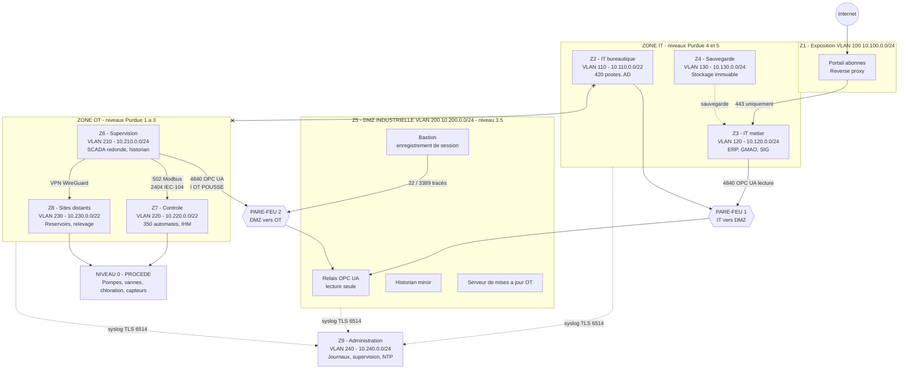

# Mise en conformité NIS2 — HydroRégie

## Réponse complète au cas pratique

---

| | |
|---|---|
| **Entité** | HydroRégie — régie des eaux, 450 000 habitants desservis |
| **Objet** | Mise en conformité à la directive (UE) 2022/2555 (NIS2) |
| **Statut de l'entité** | Entité essentielle — art. 3(1)(a), annexe I point 6 |
| **Autorité compétente** | France — ANSSI |
| **Document** | Réponse aux 4 blocs du cas pratique |
| **Date** | 10 septembre 2026 |
| **Version** | 1.0 |
| **Classification** | Diffusion restreinte |

---

## Avertissement méthodologique

Ce document distingue systématiquement trois natures d'information :

| Marqueur | Signification |
|---|---|
| 📗 **Texte** | Provient directement de la directive (UE) 2022/2555 — l'article est cité |
| 📙 **Source** | Provient d'une source officielle (ANSSI, ENISA, Légifrance) — le lien est donné |
| 📕 **Hypothèse** | Hypothèse de travail construite pour ce cas d'école (chiffres, dates, scénario) |

**Point de vigilance sur le droit applicable** (vérifié le 10 septembre 2026) : au niveau européen,
NIS2 s'applique depuis le **18 octobre 2024** (art. 41) et abroge NIS1 à cette même date (art. 44).
En France, **la loi de transposition n'est pas promulguée à ce jour** : le projet de loi
« résilience des infrastructures critiques et renforcement de la cybersécurité » a été adopté par le
Sénat les 11 et 12 mars 2025, puis voté en commission spéciale à l'Assemblée nationale le
10 septembre 2025 ; les décrets et arrêtés suivront la promulgation.

**Conséquence** : toutes les obligations citées dans ce document s'appuient sur **le texte de la
directive**, et non sur un droit français qui n'existe pas encore. Les points qui dépendront des
textes nationaux (seuils précis de qualification d'un incident, modalités exactes d'enregistrement,
calendrier d'application) sont signalés comme tels, et un jalon de revue réglementaire est inscrit
à la feuille de route.

---

## Sommaire

| Partie | Livrable | Bloc du sujet |
|---|---|---|
| **1** | Note de qualification réglementaire | Bloc 1 |
| **2** | Analyse d'écart et feuille de route de mise en conformité | Bloc 2 |
| **3** | Architecture réseau segmentée IT / OT | Bloc 3 |
| **4** | Chronologie de gestion de crise et notifications réglementaires | Bloc 4 |
| **A** | Annexe — Alerte précoce (24 h) | Bloc 4 |
| **B** | Annexe — Notification d'incident (72 h) | Bloc 4 |
| **C** | Annexe — Rapport final (1 mois) | Bloc 4 |
| **D** | Annexe — Information des usagers | Bloc 4 |
| **E** | Annexe — Notification CNIL (RGPD) | Bloc 4 |

---

## Le projet en une page

**Le contexte.** HydroRégie capte, traite, stocke et distribue l'eau potable à 450 000 habitants
répartis sur 62 communes, pour 240 000 abonnés facturés. Son système d'information de gestion (IT)
et son système industriel (OT) partagent aujourd'hui **le même réseau**, sans aucun cloisonnement.
Un courrier de l'autorité nationale vient de confirmer son statut d'**entité essentielle**.

**Le risque.** Sur un réseau plat, une compromission bureautique — une pièce jointe piégée, un mot
de passe volé — donne un accès direct aux automates qui commandent les pompes, les vannes et la
chloration. L'enjeu n'est pas la fuite de données : c'est **la continuité et la qualité de l'eau
potable**, donc la santé publique.

**La réponse, en quatre temps.**

1. **Qualifier** — HydroRégie relève de l'annexe I, point 6 (eau potable) et dépasse les seuils de
   la grande entreprise : elle est **entité essentielle** au titre de l'article 3(1)(a). La
   qualification est confirmée par trois voies indépendantes.
2. **Mesurer** — Sa maturité au regard des dix domaines de l'article 21 est de **0,6 sur 4**, avec
   **18 écarts** dont **6 critiques**. Un plan de 24 mois, chiffré à environ **956 k€**, porte cette
   maturité à **3,3 sur 4**.
3. **Concevoir** — Une architecture en **9 zones**, séparées par **deux pare-feu en cascade** et une
   **DMZ industrielle** qui constitue le seul point de rencontre entre l'IT et l'OT. Aucun flux
   direct entre la bureautique et l'industriel ; le seul protocole franchissant une frontière de
   zone est OPC UA, authentifié et chiffré.
4. **S'entraîner** — Un scénario de crise complet montre que les délais de **24 heures**,
   **72 heures** et **un mois** sont tenables, et surtout que **l'eau continue de couler** pendant
   six jours d'exploitation en mode dégradé autonome.

**La conviction du projet.** La segmentation IT/OT n'est pas une exigence de conformité : c'est la
mesure qui permet de continuer à distribuer de l'eau pendant qu'on traite l'incident. Tout le reste
en découle.

---


<!-- pagebreak -->

# PARTIE 1

## Bloc 1 — Note de qualification réglementaire

> **Objet** : qualifier HydroRégie au regard de la directive (UE) 2022/2555 (NIS2) et en déduire les
> obligations applicables.
> **Destinataire** : Direction générale d'HydroRégie
> **Rédacteur** : équipe projet mise en conformité NIS2
> **Date** : 10 septembre 2026
> **Version** : 1.0
> **Classification** : Diffusion restreinte

---

### 1. Synthèse pour la direction

> 🔴 **HydroRégie est une ENTITÉ ESSENTIELLE au sens de l'article 3(1)(a) de la directive
> (UE) 2022/2555.**

| Élément | Conclusion |
|---|---|
| **Secteur** | Eau potable — **annexe I, point 6** de la directive |
| **Taille** | **Grande entreprise** (380 salariés ≥ 250 ; 72 M€ de CA et 95 M€ de bilan) |
| **Statut** | 🔴 **Entité essentielle** — art. 3(1)(a) |
| **Autorité compétente** | France — ANSSI (art. 26(1)) |
| **Obligations principales** | Gouvernance (art. 20), mesures de gestion des risques (art. 21), notification des incidents (art. 23), enregistrement (art. 3(4)) |
| **Supervision** | *Ex ante* et *ex post* (art. 32) : audits, inspections et scans **sans incident préalable** |
| **Sanction maximale encourue** | **10 000 000 €** ou **2 %** du CA mondial annuel, le montant le plus élevé (art. 34(4)) ; interdiction temporaire d'exercer pour un dirigeant (art. 32(5)(b)) |

**La qualification est confirmée par trois voies indépendantes** (secteur + effectif, secteur +
critères financiers, et impact santé publique au titre de l'art. 2(2)). Elle n'est pas discutable.

---

### 2. Méthode de qualification

La qualification suit le raisonnement en quatre questions imposé par le texte :

```
Q1  Mon secteur figure-t-il aux annexes I ou II ?          -> art. 2(1)
Q2  Quelle est ma taille (recommandation 2003/361/CE) ?    -> art. 2(1)
Q3  Le croisement secteur x taille donne quel statut ?     -> art. 3(1) et 3(2)
Q4  Un cas particulier modifie-t-il la conclusion ?        -> art. 2(2), art. 3(1)(b)-(g)
```

---

### 3. Q1 — Le secteur d'activité

#### 3.1 L'activité d'HydroRégie

HydroRégie assure le **captage, la production, le stockage et la distribution d'eau destinée à la
consommation humaine** pour 62 communes et 450 000 habitants, avec 240 000 abonnés facturés.

#### 3.2 Le rattachement à l'annexe I

📗 L'**annexe I de la directive** liste 11 secteurs dits « hautement critiques ». Le **point 6 —
Eau potable** vise :

> les **fournisseurs et distributeurs d'eau destinée à la consommation humaine** au sens de
> l'article 2, point 1 a), de la directive (UE) 2020/2184, **à l'exclusion** des distributeurs pour
> lesquels la distribution d'eau destinée à la consommation humaine constitue une **partie non
> essentielle** de leur activité générale de distribution d'autres produits et biens.

#### 3.3 Vérification de l'exclusion

| Critère | Analyse | Résultat |
|---|---|---|
| L'eau distribuée est-elle destinée à la consommation humaine ? | Oui, au sens de la directive (UE) 2020/2184 | ✅ Dans le champ |
| La distribution d'eau est-elle une activité **accessoire** ? | **Non** : c'est l'activité **unique et principale** de la régie | ✅ **Exclusion non applicable** |

📕 *Hypothèse retenue : HydroRégie exploite exclusivement l'eau potable ; l'assainissement relève
d'un syndicat distinct. Si HydroRégie exploitait également les eaux usées, elle relèverait en outre
du point 7 de l'annexe I, sans changement de statut mais avec un périmètre déclaré élargi.*

#### 3.4 Indifférence de la forme juridique

📗 L'article 6, point 38, définit l'« entité » comme **toute personne physique ou morale créée et
reconnue comme telle en vertu du droit national**. La qualité de régie publique, d'EPIC ou de
société publique locale est donc **sans incidence** : l'annexe I vise l'**activité**, pas le statut.

> ✅ **Conclusion Q1** : HydroRégie relève de l'**annexe I, point 6**.

---

### 4. Q2 — La taille de l'entité

📗 L'article 2(1) renvoie à l'article 2 de l'annexe à la **recommandation 2003/361/CE**.

#### 4.1 Les seuils

| Catégorie | Effectif | Critères financiers |
|---|---|---|
| Moyenne entreprise | < 250 | CA ≤ 50 M€ **ou** bilan ≤ 43 M€ |
| **Grande entreprise** (dépasse les plafonds) | **≥ 250** | **ou** CA > 50 M€ **et** bilan > 43 M€ |

#### 4.2 Application à HydroRégie 📕

| Donnée | Valeur HydroRégie | Seuil « grande entreprise » | Résultat |
|---|---|---|---|
| Effectif | **380 salariés** | ≥ 250 | ✅ **Dépassé** |
| Chiffre d'affaires annuel | **72 M€** | > 50 M€ | ✅ Dépassé |
| Total de bilan | **95 M€** | > 43 M€ | ✅ Dépassé |

> 🔑 **Le critère d'effectif suffit à lui seul** : 380 ≥ 250. Les critères financiers, tous deux
> dépassés, confirment la qualification par une **seconde voie indépendante**.

#### 4.3 Vérification de la consolidation

📗 La recommandation 2003/361/CE impose de consolider les données des **entreprises liées et
partenaires**.
📕 *Hypothèse : HydroRégie ne détient aucune filiale et n'est détenue par aucune entreprise au sens
de la recommandation (elle est rattachée à un établissement public de coopération intercommunale,
qui n'est pas une « entreprise » au sens du texte). La consolidation ne modifie donc pas le calcul.*
**À faire vérifier par le service juridique** avant l'enregistrement officiel.

> ✅ **Conclusion Q2** : HydroRégie est une **grande entreprise** au sens de NIS2.

---

### 5. Q3 — Le croisement secteur × taille

| | Annexe I | Annexe II |
|---|---|---|
| **Grande entreprise** | 🔴 **Entité essentielle** — art. 3(1)(a) | Entité importante |
| Moyenne entreprise | Entité importante | Entité importante |

```
Annexe I, point 6 (eau potable)  +  grande entreprise (380 salaries)
                        |
                        v
              Article 3(1)(a)
                        |
                        v
            >> ENTITE ESSENTIELLE <<
```

> ✅ **Conclusion Q3** : HydroRégie est une **entité essentielle** au titre de l'article 3(1)(a).

---

### 6. Q4 — Vérification des cas particuliers

#### 6.1 Les cas de l'article 2(2) — entités concernées quelle que soit leur taille

| Cas | Applicable à HydroRégie ? | Analyse |
|---|---|---|
| 2(2)(a) — communications électroniques | ❌ Non | — |
| 2(2)(b) — services de confiance | ❌ Non | — |
| 2(2)(c) — DNS / TLD | ❌ Non | — |
| 2(2)(d) — **seul prestataire** dans l'État d'un service essentiel | 🟡 Partiellement | HydroRégie est **le seul** distributeur d'eau potable sur son territoire, sans alternative pour les usagers |
| 2(2)(e) — **impact important sur la santé publique** | ✅ **Oui** | Une altération de la qualité ou une rupture de distribution affecte directement la santé de 450 000 personnes |
| 2(2)(f) — risque systémique | 🟡 Partiellement | Interconnexions avec les réseaux voisins |
| 2(2)(g) — importance particulière au niveau régional | ✅ **Oui** | Service vital à l'échelle de l'agglomération |
| 2(2)(h) — administration publique | ❌ Non applicable en tant que tel | La régie exerce une activité industrielle et commerciale |

> 🔑 **Conséquence** : même si HydroRégie n'atteignait **pas** les seuils de taille, elle serait dans
> le champ de la directive par l'article 2(2), points (e) et (g). La qualification est donc
> **robuste face à une évolution de ses effectifs ou de son chiffre d'affaires**.

#### 6.2 Les autres voies vers le statut essentiel (art. 3(1)(b) à (g))

| Voie | Applicable ? |
|---|---|
| 3(1)(b) — services de confiance qualifiés, TLD, DNS | ❌ Non |
| 3(1)(c) — communications électroniques, moyenne entreprise | ❌ Non |
| 3(1)(d) et (e) — administration publique | ❌ Non |
| 3(1)(f) — **entité critique au titre de la directive (UE) 2022/2557 (REC)** | 🟡 **À vérifier** — si HydroRégie est identifiée comme entité critique au titre de la directive REC, elle serait **en outre** essentielle par cette voie, avec des obligations de résilience **physique** supplémentaires |
| 3(1)(g) — ancien opérateur de services essentiels (NIS1) | 🟡 **À vérifier** auprès de l'autorité |

> ⚠️ **Point de vigilance à porter à la direction** : la directive REC (UE) 2022/2557 est transposée
> par **le même projet de loi français** que NIS2. Si HydroRégie est désignée entité critique, elle
> devra également conduire une **évaluation des risques** et un **plan de résilience** couvrant les
> risques physiques (intrusion, sabotage, catastrophe naturelle). **À clarifier dès la promulgation.**

#### 6.3 Le courrier de l'autorité nationale

Le courrier reçu **confirme** le statut d'entité essentielle. Il est important de comprendre sa
portée juridique exacte :

| Ce que le courrier fait | Ce que le courrier ne fait pas |
|---|---|
| Il **confirme** une qualification qui résulte de la loi | Il ne **crée** pas l'obligation |
| Il identifie HydroRégie auprès de l'autorité | Il ne dispense pas de l'enregistrement (art. 3(4)) |
| Il fixe l'interlocuteur | Il ne fixe pas de délai de mise en conformité propre |

> 📗 L'obligation naît du **texte**, pas du courrier. Une entité qui n'aurait reçu aucun courrier
> resterait pleinement soumise à la directive : le système NIS2 repose sur l'**auto-qualification**.

> ✅ **Conclusion Q4** : la qualification d'entité essentielle est **confirmée et renforcée**.

---

### 7. Les obligations qui découlent du statut

#### 7.1 Vue d'ensemble

| # | Obligation | Article | Échéance |
|---|---|---|---|
| 1 | **Enregistrement** auprès de l'autorité nationale (nom, adresse, coordonnées, secteur, plages IP) | 3(4) | Dès l'ouverture de l'enregistrement obligatoire ; **pré-enregistrement possible dès maintenant** sur MonEspaceNIS2 |
| 2 | Mise à jour des informations en cas de changement | 3(4) | **Sous 2 semaines** |
| 3 | **Gouvernance** : approbation par la direction, supervision, formation des dirigeants | 20 | Immédiat |
| 4 | **Mesures de gestion des risques** couvrant les 10 domaines | 21(2) | Immédiat, avec plan de progression |
| 5 | Prise en compte des **fournisseurs directs** | 21(3) | Immédiat |
| 6 | **Correction sans délai** des non-conformités constatées | 21(4) | Permanent |
| 7 | **Notification des incidents importants** : 24 h / 72 h / 1 mois | 23(4) | Permanent — **procédure à écrire en priorité** |
| 8 | **Information des destinataires** des services affectés | 23(1) | Permanent |
| 9 | Information en cas de **cybermenace importante** | 23(2) | Permanent |

#### 7.2 Ce que le statut « essentiel » ajoute par rapport à « important »

| | Entité essentielle (HydroRégie) | Entité importante |
|---|---|---|
| Supervision | **Ex ante et ex post** — audits, inspections sur site, scans **sans incident** (art. 32(2)) | Ex post uniquement (art. 33) |
| Coût des audits ciblés | **À la charge de l'entité** (art. 32(7)) | — |
| Amende maximale | **10 M€ ou 2 %** du CA mondial, le plus élevé (art. 34(4)) | 7 M€ ou 1,4 % (art. 34(5)) |
| Suspension d'agrément | **Possible** (art. 32(5)(a)) | Non prévue |
| Interdiction temporaire d'exercer pour un dirigeant | **Possible** (art. 32(5)(b)) | Non prévue |

> 💡 **Message à la direction** : les mesures à mettre en œuvre sont les mêmes qu'une entité
> importante. Ce qui change, c'est que **le contrôle peut arriver sans prévenir et sans incident**,
> et que la responsabilité personnelle du directeur général est engagée.

---

### 8. L'articulation avec les autres réglementations

| Texte | Applicable à HydroRégie ? | Articulation |
|---|---|---|
| **RGPD** — règlement (UE) 2016/679 | ✅ Oui — 240 000 abonnés | **Cumul** des obligations de notification (CNIL 72 h **et** ANSSI 24 h/72 h/1 mois). Pas de cumul des **amendes** pour le même comportement (art. 35 NIS2) |
| **Directive REC** — (UE) 2022/2557 | 🟡 À vérifier | Si désignée entité critique : obligations de résilience physique **en plus**, et statut essentiel confirmé par l'art. 3(1)(f) |
| **Directive (UE) 2020/2184** — eau destinée à la consommation humaine | ✅ Oui | Qualité de l'eau et évaluation des risques du système de distribution. **Complémentaire**, pas substituable |
| **DORA** — règlement (UE) 2022/2554 | ❌ Non | Secteur financier uniquement |
| **Art. 4 NIS2** (*lex specialis*) | ❌ Sans effet ici | Aucun acte sectoriel de l'Union n'impose au secteur de l'eau des obligations équivalentes |

---

### 9. Périmètre du système d'information concerné

📗 L'article 6, point 1, définit le « réseau et système d'information » de façon suffisamment large
pour couvrir **l'ensemble** des équipements traitant des données numériques.

| Domaine | Composants | Dans le périmètre NIS2 ? |
|---|---|---|
| **IT bureautique** | 420 postes, AD, messagerie M365, serveurs de fichiers | ✅ Oui |
| **IT métier** | ERP de facturation, portail abonnés, GMAO, SIG | ✅ Oui |
| **OT supervision** | Superviseur SCADA redondé, historian | ✅ Oui |
| **OT contrôle** | ~350 automates et RTU, IHM locales | ✅ **Oui** |
| **Télérelève** | 60 000 compteurs communicants et leur concentrateur | ✅ Oui |
| **Réseau** | Commutateurs, liaisons fibre, APN 4G privé, VPN | ✅ Oui |
| Équipements purement mécaniques sans électronique | Vannes manuelles | ❌ Non |

> 🔴 **Conclusion structurante** : l'OT est **pleinement dans le périmètre**. Il n'existe aucune
> possibilité d'exclure le système industriel de la conformité. Comme l'IT et l'OT ne sont
> aujourd'hui **pas cloisonnés**, l'ensemble constitue un **périmètre unique et indivisible** —
> ce qui rend la segmentation (bloc 3) indispensable, y compris pour **réduire le périmètre à
> protéger**.

---

### 10. Conclusion et recommandations immédiates

#### 10.1 Conclusion

HydroRégie est une **entité essentielle** au sens de l'article 3(1)(a) de la directive
(UE) 2022/2555, en tant qu'entité relevant de l'annexe I point 6 (eau potable) dépassant les seuils
de la moyenne entreprise. Cette qualification est confirmée par le courrier de l'autorité nationale
et renforcée par l'article 2(2), points (e) et (g).

#### 10.2 Les 5 actions à engager immédiatement

| # | Action | Responsable | Échéance |
|---|---|---|---|
| 1 | Créer le compte **MonEspaceNIS2** et procéder au pré-enregistrement | DSI | 15 jours |
| 2 | Désigner un **référent NIS2** et un suppléant, avec lettre de mission signée du DG | Direction générale | 15 jours |
| 3 | Créer le **comité de sécurité des SI (COSSI)** par délibération — art. 20(1) | Direction générale | 1 mois |
| 4 | Écrire la **procédure de notification 24 h / 72 h / 1 mois** — art. 23 | RSSI | **1 mois** (priorité absolue : un incident peut survenir avant la fin du plan) |
| 5 | Vérifier auprès de l'autorité si HydroRégie est visée par la **directive REC** | Juridique | 2 mois |

#### 10.3 Réserve de rédaction

📙 À la date de cette note (**10 septembre 2026**), **la loi française de transposition n'est pas
promulguée**. Le projet de loi « résilience des infrastructures critiques et renforcement de la
cybersécurité » a été adopté par le Sénat les 11-12 mars 2025 et voté en commission spéciale à
l'Assemblée nationale le 10 septembre 2025 ; les décrets suivront.

**Conséquence** : la présente note s'appuie sur le **texte de la directive**. Les seuils précis de
qualification d'un incident significatif, les modalités exactes d'enregistrement et le calendrier
d'application en France seront fixés par les textes nationaux. Une **revue de conformité est
inscrite au plan d'actions**, déclenchée par leur publication.

Cela ne justifie **aucun report** : les mesures techniques et organisationnelles nécessaires
demandent 18 à 24 mois de mise en œuvre.

---

### 📚 Fondements cités

| Référence | Objet |
|---|---|
| Directive (UE) 2022/2555, **art. 2(1)** | Règle générale du champ d'application |
| Directive (UE) 2022/2555, **art. 2(2)** points (d), (e), (g) | Entités concernées quelle que soit leur taille |
| Directive (UE) 2022/2555, **art. 3(1)(a)** | Entité essentielle — annexe I + grande entreprise |
| Directive (UE) 2022/2555, **art. 3(4)** | Obligation d'enregistrement et de mise à jour |
| Directive (UE) 2022/2555, **art. 6** point 1 et point 38 | Définitions de « réseau et système d'information » et d'« entité » |
| Directive (UE) 2022/2555, **annexe I, point 6** | Secteur de l'eau potable |
| Directive (UE) 2022/2555, **art. 20, 21, 23** | Obligations de fond |
| Directive (UE) 2022/2555, **art. 26(1)** | Compétence territoriale |
| Directive (UE) 2022/2555, **art. 32, 33, 34** | Supervision et sanctions |
| Recommandation **2003/361/CE**, annexe art. 2 | Définition des catégories d'entreprises |
| Directive **(UE) 2020/2184** | Eau destinée à la consommation humaine |
| Directive **(UE) 2022/2557** (REC) | Résilience des entités critiques |
| [ANSSI — Directive NIS 2](https://messervices.cyber.gouv.fr/nis2) | Seuils, secteurs, sanctions |
| [FAQ MonEspaceNIS2 — transposition](https://aide.monespacenis2.cyber.gouv.fr/fr/article/avancement-de-la-transposition-de-la-directive-nis-2-1b3j1da/) | État de la transposition française |

---


<!-- pagebreak -->

# PARTIE 2

## Bloc 2 — Analyse d'écart et feuille de route de mise en conformité

> **Objet** : mesurer l'écart entre la situation actuelle d'HydroRégie et les exigences de
> l'article 21 de la directive (UE) 2022/2555, puis bâtir un plan d'actions daté et responsabilisé.
> **Date** : 10 septembre 2026 · **Version** : 1.0 · **T0 du plan** : 1ᵉʳ octobre 2026
> **Classification** : Diffusion restreinte

---

### 1. Synthèse pour la direction

| Indicateur | Valeur |
|---|---|
| Domaines de l'article 21(2) évalués | **10 / 10** |
| Maturité moyenne actuelle | **0,6 / 4** |
| Maturité cible à 24 mois | **3,3 / 4** |
| Écarts identifiés | **18** |
| Écarts critiques (à traiter sous 3 mois) | **6** |
| Durée du plan | **24 mois** (octobre 2026 → septembre 2028) |
| Budget total estimé 📕 | **≈ 956 k€** dont **≈ 520 k€ d'investissement** et **≈ 436 k€ de fonctionnement sur 2 ans** |
| Amende maximale encourue en cas de manquement | **10 000 000 €** (art. 34(4)) |

> 🎯 **Le message en une phrase** : la mise en conformité coûte **moins d'un dixième** de l'amende
> maximale encourue, et **environ un tiers** du coût estimé d'un seul incident majeur
> (1,5 à 4 M€ 📕).

#### Le risque majeur, en une image

```
Aujourd'hui : reseau PLAT
  [Poste bureautique] --- rien ne bloque ---> [Automate de pompe]
  Une piece jointe piegee peut arreter la distribution d'eau de 450 000 habitants.

Cible : reseau SEGMENTE
  [Poste bureautique] --X-- [pare-feu] --X-- [DMZ] --X-- [pare-feu] --X-- [Automate]
  L'incident reste dans l'IT ; l'eau continue de couler.
```

---

### 2. Méthode d'évaluation

#### 2.1 Référentiel

L'évaluation porte sur les **10 domaines de l'article 21(2)** de la directive, complétés par
l'**article 20** (gouvernance) et l'**article 23** (notification). Les mesures techniques sont
appréciées au regard du **guide ANSSI sur la cybersécurité des systèmes industriels** et de la
norme **IEC 62443**, conformément à ce que permet l'article 25.

#### 2.2 Échelle de maturité

| Niveau | Nom | Critère |
|---|---|---|
| **0** | Inexistant | Le sujet n'est pas identifié, rien n'est fait |
| **1** | Initialisé | Des actions existent, informelles, dépendantes des personnes |
| **2** | Reproductible | La pratique est écrite, mais pas systématiquement appliquée |
| **3** | Défini | Procédure formalisée, appliquée, connue, avec des preuves |
| **4** | Maîtrisé | Mesurée par des indicateurs, contrôlée, améliorée |

🎯 **Cible retenue** : **niveau 3 minimum** sur tous les domaines, **niveau 4** sur les quatre
domaines critiques pour une entité essentielle du secteur de l'eau : gestion des incidents (b),
continuité (c), contrôle d'accès (i), MFA et communications d'urgence (j).

#### 2.3 Sources de l'évaluation 📕

Entretiens avec la DSI, l'exploitation et les deux intégrateurs ; revue documentaire ; inventaire
technique partiel ; capture réseau passive de 15 jours ; revue des comptes Active Directory ;
revue des contrats fournisseurs.

---

### 3. La cotation, domaine par domaine

| # | Art. | Domaine | Actuel | Cible | Écart | Criticité |
|---|---|---|---|---|---|---|
| 1 | 21(2)(a) | Analyse des risques et sécurité des SI | **0** | 3 | 3 | 🟠 Élevée |
| 2 | 21(2)(b) | Gestion des incidents | **1** | 4 | 3 | 🔴 **Critique** |
| 3 | 21(2)(c) | Continuité, sauvegardes, gestion de crise | **1** | 4 | 3 | 🔴 **Critique** |
| 4 | 21(2)(d) | Sécurité de la chaîne d'approvisionnement | **0** | 3 | 3 | 🟠 Élevée |
| 5 | 21(2)(e) | Acquisition, maintenance, vulnérabilités | **1** | 3 | 2 | 🟠 Élevée |
| 6 | 21(2)(f) | Évaluation de l'efficacité des mesures | **0** | 3 | 3 | 🟡 Moyenne |
| 7 | 21(2)(g) | Cyberhygiène et formation | **1** | 3 | 2 | 🟠 Élevée |
| 8 | 21(2)(h) | Cryptographie et chiffrement | **1** | 3 | 2 | 🟡 Moyenne |
| 9 | 21(2)(i) | RH, contrôle d'accès, gestion des actifs | **1** | 4 | 3 | 🔴 **Critique** |
| 10 | 21(2)(j) | MFA et communications sécurisées | **0** | 4 | 4 | 🔴 **Critique** |
| — | art. 20 | Gouvernance | **0** | 4 | 4 | 🔴 **Critique** |
| — | art. 23 | Notification des incidents | **0** | 4 | 4 | 🔴 **Critique** |

**Maturité moyenne actuelle : 0,6 / 4.**

#### Représentation

```
Art. 21(2)  Niveau actuel (#) / cible (o)
(a) risques      # . . o .      0 -> 3
(b) incidents    . # . . o      1 -> 4
(c) continuite   . # . . o      1 -> 4
(d) fournisseurs # . . o .      0 -> 3
(e) vulnerab.    . # . o .      1 -> 3
(f) efficacite   # . . o .      0 -> 3
(g) hygiene      . # . o .      1 -> 3
(h) crypto       . # . o .      1 -> 3
(i) acces        . # . . o      1 -> 4
(j) MFA / comm.  # . . . o      0 -> 4
art. 20 gouv.    # . . . o      0 -> 4
art. 23 notif.   # . . . o      0 -> 4
                 0 1 2 3 4
```

---

### 4. Le détail des 18 écarts

> Format : constat factuel → risque concret → action → article couvert.

#### 🔴 Écarts critiques (traitement sous 3 mois)

---

##### ECART-01 — Aucun cloisonnement entre l'IT et l'OT
- **Article** : 21(2)(a), (b), (c), (i)
- **Constat** : un plan d'adressage unique (10.0.0.0/8), aucun VLAN ni pare-feu entre la bureautique
  et les automates. Un poste bureautique peut ouvrir une session Modbus/TCP (port 502) vers
  n'importe quel automate.
- **Risque** : une compromission bureautique (hameçonnage) donne un accès direct au pilotage des
  pompes, des vannes et de la chloration. **Impact potentiel : santé publique.**
- **Action** : projet de segmentation complet — voir bloc 3.
- **Maturité** : 0 → 3 · **Effort** : élevé · **Délai** : 18 mois (jalons intermédiaires dès 3 mois)

---

##### ECART-02 — Aucune procédure de notification des incidents
- **Article** : **23**
- **Constat** : aucune procédure écrite, aucun modèle de notification, aucun critère de
  qualification d'un incident important, aucun circuit de validation.
- **Risque** : dépassement des délais **24 h / 72 h / 1 mois** dès le premier incident.
  **Manquement direct** à l'article 23, sanctionnable au titre de l'article 34(4).
- **Action** : rédiger la procédure, les 3 modèles de notification, la grille de qualification et la
  liste de contacts ; les diffuser **sur papier**.
- **Maturité** : 0 → 3 · **Effort** : **faible** · **Délai** : **1 mois** 🔥
- 💡 *Écart le plus rentable du plan : quelques jours de travail, un risque de sanction supprimé.*

---

##### ECART-03 — Accès distant des intégrateurs non maîtrisé
- **Article** : 21(2)(d), (i), (j)
- **Constat** : deux intégrateurs disposent d'un accès **TeamViewer permanent** sur le poste
  d'ingénierie automates, via un **compte partagé**, sans MFA, sans traçabilité, avec un mot de
  passe transmis par courriel il y a trois ans.
- **Risque** : **le vecteur d'attaque documenté** contre les opérateurs d'eau. Aucune capacité à
  savoir qui s'est connecté ni ce qui a été modifié.
- **Action** : suppression de TeamViewer ; VPN nominatif + MFA + bastion avec enregistrement de
  session ; comptes **désactivés par défaut**, activés sur ticket pour une fenêtre limitée.
- **Maturité** : 0 → 4 · **Effort** : moyen · **Délai** : **3 mois**

---

##### ECART-04 — Sauvegardes vulnérables à un rançongiciel
- **Article** : 21(2)(c)
- **Constat** : sauvegardes sur un **NAS unique**, sur le même réseau, accessible avec les
  identifiants du domaine. Aucune copie hors ligne. Aucun test de restauration documenté depuis
  plus de 24 mois. **Les programmes automates ne sont pas sauvegardés** (ils résident sur le disque
  du poste d'ingénierie).
- **Risque** : un rançongiciel chiffre les données **et** les sauvegardes. La perte des programmes
  automates rendrait la reconstruction d'un site impossible en moins de plusieurs semaines.
- **Action** : règle **3-2-1-1-0** ; copie hors ligne (bande sortie du robot) ou stockage immuable ;
  compte de sauvegarde hors du domaine ; **versionnement des programmes automates** ; tests de
  restauration trimestriels documentés.
- **Maturité** : 1 → 4 · **Effort** : moyen · **Délai** : **3 mois**

---

##### ECART-05 — Aucune authentification multifacteur
- **Article** : 21(2)(j)
- **Constat** : pas de MFA sur la messagerie Microsoft 365, ni sur le VPN, ni sur les comptes
  d'administration.
- **Risque** : un seul mot de passe volé (hameçonnage, fuite externe, réutilisation) suffit à entrer.
- **Action** : MFA obligatoire par ordre de priorité — comptes d'administration, accès distants,
  messagerie, puis ensemble des utilisateurs.
- **Maturité** : 0 → 4 · **Effort** : **faible** · **Délai** : **3 mois** 🔥

---

##### ECART-06 — Aucune gouvernance de la sécurité
- **Article** : **20**
- **Constat** : aucune instance dédiée, aucune PSSI, aucun RSSI identifié, aucun dirigeant formé,
  aucun budget sécurité isolé.
- **Risque** : manquement direct à l'article 20 ; **responsabilité personnelle** des dirigeants
  (art. 20(1)) et interdiction temporaire d'exercer possible (art. 32(5)(b)).
- **Action** : créer le **COSSI** par délibération ; recruter ou désigner un **RSSI** avec lettre de
  mission ; former les membres de la direction ; approuver formellement PSSI et feuille de route.
- **Maturité** : 0 → 4 · **Effort** : faible à moyen · **Délai** : **3 mois**

---

#### 🟠 Écarts élevés (traitement sous 9 mois)

---

##### ECART-07 — Aucune analyse de risques formalisée
- **Article** : 21(2)(a) · **Maturité** : 0 → 3 · **Délai** : 6 mois
- **Constat** : aucune analyse de risques, aucune PSSI, aucune cartographie des scénarios redoutés.
- **Risque** : impossible de justifier la **proportionnalité** des mesures devant un contrôle.
- **Action** : analyse **EBIOS Risk Manager** couvrant IT **et** OT, avec 5 scénarios stratégiques
  (rançongiciel, sabotage de la chloration, compromission par un fournisseur, indisponibilité de la
  télégestion, vol de données abonnés) ; PSSI dérivée et approuvée par le COSSI.

---

##### ECART-08 — Inventaire des actifs incomplet
- **Article** : 21(2)(i) · **Maturité** : 1 → 3 · **Délai** : 6 mois
- **Constat** : l'inventaire IT est partiel et l'inventaire OT **inexistant** — le nombre d'automates
  est estimé « environ 350 », sans liste ni versions de firmware.
- **Risque** : impossible de répondre à un avis de sécurité (« combien d'équipements concernés ? »),
  impossible de segmenter correctement, impossible de savoir ce qu'on protège.
- **Action** : inventaire exhaustif IT et OT (marque, modèle, version, localisation, criticité,
  responsable, fournisseur) ; découverte **passive** côté OT ; mise à jour continue via la GMAO.

---

##### ECART-09 — Comptes et droits non maîtrisés
- **Article** : 21(2)(i) · **Maturité** : 1 → 4 · **Délai** : 6 mois
- **Constat** : 68 comptes actifs sans connexion depuis plus de 12 mois 📕 ; comptes génériques
  partagés (`admin`, `technicien`, `scada`) ; aucune revue périodique des droits ; pas de procédure
  formalisée de départ.
- **Risque** : maintien d'accès après un départ ; impossibilité d'imputer une action.
- **Action** : revue complète, suppression des comptes génériques, nominativité, moindre privilège,
  comptes d'administration séparés des comptes bureautiques, **revue semestrielle** documentée.

---

##### ECART-10 — Aucune veille sur les vulnérabilités
- **Article** : 21(2)(e) · **Maturité** : 1 → 3 · **Délai** : 9 mois
- **Constat** : aucune veille CVE, aucun abonnement aux avis du CERT-FR, aucune politique de
  correctifs pour l'OT.
- **Risque** : exploitation de vulnérabilités connues et publiées, sur des équipements en service
  depuis 15 ans.
- **Action** : abonnement aux avis CERT-FR et éditeurs ; processus mensuel d'analyse ; politique de
  correctifs **différenciée IT / OT** ; pour l'OT non corrigeable, **mesures compensatoires
  documentées** (isolement, filtrage, surveillance renforcée) — approche explicitement admise par
  la proportionnalité de l'art. 21(1).

---

##### ECART-11 — Aucune exigence de sécurité vis-à-vis des fournisseurs
- **Article** : 21(2)(d), 21(3) · **Maturité** : 0 → 3 · **Délai** : 9 mois
- **Constat** : aucun contrat ne comporte de clause de sécurité, de délai de notification d'incident,
  ni de droit d'audit. Aucune évaluation des pratiques des intégrateurs.
- **Risque** : compromission par la chaîne d'approvisionnement, sans recours contractuel.
- **Action** : **annexe sécurité type** à insérer dans tous les contrats (notification d'incident
  sous 24 h, MFA, comptes nominatifs, droit d'audit, réversibilité, développement sécurisé) ;
  questionnaire d'évaluation des fournisseurs critiques ; clause de conformité NIS2 pour les
  fournisseurs eux-mêmes soumis à la directive.

---

##### ECART-12 — Sensibilisation quasi inexistante
- **Article** : 21(2)(g), 20(2) · **Maturité** : 1 → 3 · **Délai** : 6 mois
- **Constat** : une sensibilisation à l'arrivée, jamais renouvelée ; aucun exercice d'hameçonnage ;
  **aucun dirigeant formé** — ce qui est un manquement direct à l'article 20(2).
- **Action** : plan annuel de sensibilisation pour tous les agents ; module spécifique pour
  l'exploitation (risques OT, clés USB, accès prestataires) ; **formation obligatoire des membres du
  COSSI et de la direction** ; deux campagnes d'hameçonnage simulé par an.

---

#### 🟡 Écarts moyens (traitement sous 18 mois)

---

##### ECART-13 — Aucune journalisation centralisée
- **Article** : 21(2)(b), (f) · **Maturité** : 0 → 3 · **Délai** : 12 mois
- **Constat** : journaux locaux, rétention de 7 jours sur les pare-feu, aucune corrélation, aucune
  alerte. Les horloges ne sont pas synchronisées sur l'ensemble du parc.
- **Risque** : incapacité à détecter, à qualifier et à **reconstituer** un incident — donc à écrire
  le rapport final de l'article 23(4)(d).
- **Action** : collecteur centralisé en zone d'administration isolée, rétention 12 mois, **NTP
  généralisé**, règles d'alerte, astreinte.

---

##### ECART-14 — Aucune détection sur le réseau industriel
- **Article** : 21(2)(b) · **Maturité** : 0 → 3 · **Délai** : 15 mois
- **Constat** : aucune visibilité sur ce qui circule dans le réseau OT.
- **Action** : sonde **passive** sur port miroir ; règles prioritaires : nouvel équipement,
  écriture Modbus hors SCADA, protocole inhabituel, trafic sortant depuis l'OT.

---

##### ECART-15 — Aucun plan de continuité formalisé
- **Article** : 21(2)(c) · **Maturité** : 1 → 4 · **Délai** : 12 mois
- **Constat** : les modes dégradés existent dans la pratique des exploitants, mais ne sont ni
  écrits, ni testés, ni connus des nouveaux arrivants.
- **Action** : formaliser les trois modes (nominal, dégradé autonome, manuel) ; définir RTO et RPO
  par système ; **tester la bascule en mode dégradé une fois par an** ; exercice de crise annuel.

---

##### ECART-16 — Chiffrement absent
- **Article** : 21(2)(h) · **Maturité** : 1 → 3 · **Délai** : 12 mois
- **Constat** : sauvegardes non chiffrées, postes portables non chiffrés, flux d'administration en
  clair (Telnet encore actif sur d'anciens commutateurs 📕).
- **Action** : politique de cryptographie ; chiffrement des sauvegardes et des postes nomades ;
  suppression de Telnet et HTTP au profit de SSH et HTTPS ; gestion des clés documentée.

---

##### ECART-17 — Aucune évaluation de l'efficacité des mesures
- **Article** : 21(2)(f) · **Maturité** : 0 → 3 · **Délai** : 18 mois
- **Constat** : aucun audit, aucun test d'intrusion, aucun indicateur.
- **Action** : tableau de bord trimestriel présenté au COSSI ; audit de configuration annuel ;
  test d'intrusion externe annuel sur le périmètre IT ; **audit de segmentation** après la mise en
  œuvre du bloc 3.

---

##### ECART-18 — Documentation d'architecture obsolète
- **Article** : 21(2)(a), (c) · **Maturité** : 1 → 3 · **Délai** : 12 mois
- **Constat** : les schémas réseau datent de 2019 et ne reflètent plus la réalité ; plusieurs
  liaisons ajoutées depuis ne figurent nulle part.
- **Risque** : en crise, on perd des heures à comprendre son propre réseau.
- **Action** : cartographie à jour, versionnée dans un dépôt Git, **avec une copie papier dans la
  salle de crise**, revue semestrielle.

---

### 5. Priorisation

#### 5.1 Matrice impact / effort

```
              EFFORT FAIBLE                 EFFORT ELEVE
            +---------------------------+---------------------------+
   IMPACT   | 1. A FAIRE TOUT DE SUITE  | 2. PROJETS STRUCTURANTS   |
   FORT     |  E-02 notification        |  E-01 segmentation IT/OT  |
            |  E-05 MFA                 |  E-13 journalisation      |
            |  E-04 sauvegardes         |  E-14 detection OT        |
            |  E-06 gouvernance         |  E-03 acces distants      |
            +---------------------------+---------------------------+
   IMPACT   | 3. QUAND ON PEUT          | 4. PLUS TARD              |
   MODERE   |  E-08 inventaire          |  E-17 audits / tests      |
            |  E-09 revue des comptes   |  E-16 chiffrement complet |
            |  E-12 sensibilisation     |  E-11 refonte contrats    |
            |  E-18 documentation       |                           |
            +---------------------------+---------------------------+
```

#### 5.2 Les 4 actions à mener en priorité absolue

| Rang | Écart | Pourquoi en premier | Délai |
|---|---|---|---|
| 1 | **E-02** procédure de notification | Coût quasi nul, supprime un risque de sanction immédiat | 1 mois |
| 2 | **E-05** MFA | Meilleur rapport protection / effort de tout le plan | 3 mois |
| 3 | **E-04** sauvegardes hors ligne | C'est ce qui permet de **survivre** à un rançongiciel | 3 mois |
| 4 | **E-03** accès distants | Ferme le vecteur d'attaque le plus documenté du secteur | 3 mois |

> 💡 **Ces quatre actions représentent environ 12 % du budget total** et couvrent une part
> majoritaire du risque de court terme. C'est l'argument à porter au COSSI dès la première séance.

---

### 6. La feuille de route

**T0 = 1ᵉʳ octobre 2026** (première réunion du COSSI).

#### Vue d'ensemble

```
2026        2027                              2028
Q4    | Q1     Q2     Q3     Q4        | Q1     Q2     Q3
------+--------------------------------+------------------
PHASE 0  |  PHASE 1        |  PHASE 2          |  PHASE 3
Urgences |  Socle          |  Segmentation     |  Maitrise
3 mois   |  6 mois         |  9 mois           |  6 mois
```

---

#### 🔥 PHASE 0 — Urgences (oct. → déc. 2026)

*Objectif : supprimer les risques les plus graves au moindre coût, et poser la gouvernance.*

| ID | Action | Écart | Responsable | Échéance | Coût 📕 | Preuve de clôture |
|---|---|---|---|---|---|---|
| A-01 | Créer le COSSI par délibération | E-06 | **Direction générale** | 31/10/2026 | — | Délibération + PV de la 1ʳᵉ séance |
| A-02 | Désigner le RSSI (lettre de mission signée) | E-06 | **Direction générale** | 31/10/2026 | 65 k€/an | Lettre de mission |
| A-03 | Créer le compte MonEspaceNIS2 et pré-enregistrer | art. 3(4) | **DSI** | 31/10/2026 | — | Accusé d'enregistrement |
| A-04 | Rédiger la procédure de notification + 3 modèles + grille de qualification | E-02 | **RSSI** | 30/11/2026 | — | Procédure validée en COSSI, **diffusée sur papier** |
| A-05 | Activer le MFA sur les comptes d'administration et les accès distants | E-05 | **DSI** | 30/11/2026 | 8 k€ | Capture de configuration + test |
| A-06 | Mettre en place une copie de sauvegarde **hors ligne** hebdomadaire | E-04 | **DSI** | 15/12/2026 | 35 k€ | Procédure + première bande sortie |
| A-07 | Sauvegarder et versionner **tous les programmes automates** | E-04 | **Resp. exploitation** | 15/12/2026 | 5 k€ | Dépôt Git + inventaire des programmes |
| A-08 | Supprimer TeamViewer, déployer VPN + MFA + bastion | E-03 | **DSI** + prestataire | 31/12/2026 | 45 k€ | Configuration + procédure d'intervention |
| A-09 | Constituer l'annuaire de crise **papier** et une messagerie hors domaine | E-02, art. 21(2)(j) | **RSSI** | 31/12/2026 | 2 k€ | Annuaire diffusé + test réalisé |
| A-10 | Vérifier l'assujettissement à la directive REC | — | **Juridique** | 31/12/2026 | — | Réponse écrite de l'autorité |

**Sous-total phase 0 : ≈ 95 k€ + 65 k€/an (RSSI)**

---

#### 🧱 PHASE 1 — Socle (janv. → juin 2027)

*Objectif : savoir ce qu'on protège, et rendre la protection mesurable.*

| ID | Action | Écart | Responsable | Échéance | Coût 📕 | Preuve de clôture |
|---|---|---|---|---|---|---|
| A-11 | Analyse de risques EBIOS RM (IT + OT), 5 scénarios stratégiques | E-07 | **RSSI** + cabinet | 31/03/2027 | 35 k€ | Rapport EBIOS validé en COSSI |
| A-12 | Rédiger et faire approuver la **PSSI** | E-07 | **RSSI** | 30/04/2027 | — | PSSI + PV d'approbation (art. 20(1)) |
| A-13 | Inventaire exhaustif IT et OT | E-08 | **DSI** + exploitation | 31/03/2027 | 25 k€ | Base d'inventaire + rapprochement terrain |
| A-14 | Revue complète des comptes et des droits, suppression des comptes génériques | E-09 | **DSI** | 30/04/2027 | — | Rapport de revue + 0 compte générique |
| A-15 | Formation cyber des membres de la direction (art. 20(2)) | E-12 | **RH** + RSSI | 31/03/2027 | 12 k€ | **Attestations individuelles** |
| A-16 | Plan annuel de sensibilisation + 1ʳᵉ campagne d'hameçonnage simulé | E-12 | **RSSI** | 30/06/2027 | 15 k€ | Taux de participation + résultats |
| A-17 | Généraliser le MFA à l'ensemble des utilisateurs | E-05 | **DSI** | 30/06/2027 | 18 k€ | Taux de couverture > 95 % |
| A-18 | Annexe sécurité type dans les contrats + questionnaire fournisseurs | E-11 | **Achats** + RSSI | 30/06/2027 | — | Annexe validée + 5 contrats critiques renégociés |
| A-19 | Mettre en place la veille CVE et la politique de correctifs IT/OT | E-10 | **RSSI** | 30/06/2027 | 8 k€ | Procédure + premier rapport mensuel |
| A-20 | Cartographie réseau à jour, versionnée + copie papier en salle de crise | E-18 | **DSI** | 30/06/2027 | 10 k€ | Schémas datés dans le dépôt |
| A-21 | **Matrice de flux** IT/OT établie et validée par l'exploitation | E-01 | **DSI** + exploitation | 30/06/2027 | 20 k€ | Matrice signée — **prérequis du bloc 3** |

**Sous-total phase 1 : ≈ 143 k€**

---

#### 🔒 PHASE 2 — Segmentation (juil. 2027 → mars 2028)

*Objectif : le cœur technique du projet — cloisonner l'IT et l'OT sans interrompre le service.*

| ID | Action | Écart | Responsable | Échéance | Coût 📕 | Preuve de clôture |
|---|---|---|---|---|---|---|
| A-22 | Acquisition des équipements (2 pare-feu, commutateurs administrables, sonde) | E-01 | **DSI** | 30/09/2027 | 180 k€ | Bons de livraison |
| A-23 | Créer les VLAN et le routage, **sans filtrage** | E-01 | **DSI** | 31/10/2027 | 40 k€ | Configurations versionnées |
| A-24 | Déployer la **DMZ industrielle** (relais OPC UA, historian miroir, serveur de MAJ) | E-01 | **DSI** + intégrateur | 31/12/2027 | 95 k€ | Recette fonctionnelle |
| A-25 | Bascule des équipements par lots, IT puis OT | E-01 | **DSI** + exploitation | 31/01/2028 | 30 k€ | Journal de bascule, aucun arrêt de service |
| A-26 | Activer le filtrage en **journalisation seule** pendant 2 semaines | E-01 | **DSI** | 15/02/2028 | — | Analyse des flux non prévus |
| A-27 | Passer en **blocage effectif**, zone par zone | E-01 | **DSI** | 15/03/2028 | — | Configurations + tests de segmentation |
| A-28 | Journalisation centralisée + NTP généralisé (12 mois de rétention) | E-13 | **DSI** | 31/12/2027 | 55 k€ | Taux de couverture > 95 % |
| A-29 | Sonde de détection **passive** sur le réseau OT | E-14 | **DSI** | 31/01/2028 | 45 k€ | Alertes fonctionnelles + inventaire de référence |
| A-30 | Chiffrement des sauvegardes et des postes nomades, suppression de Telnet | E-16 | **DSI** | 31/03/2028 | 15 k€ | Rapport de configuration |
| A-31 | **Audit de segmentation** par un tiers | E-01, E-17 | **RSSI** + auditeur | 31/03/2028 | 25 k€ | 🔴 **Rapport d'audit — la preuve maîtresse** |

**Sous-total phase 2 : ≈ 485 k€**

---

#### 🎯 PHASE 3 — Maîtrise (avr. → sept. 2028)

*Objectif : passer de « mis en place » à « mesuré, testé, amélioré » (niveau 4).*

| ID | Action | Écart | Responsable | Échéance | Coût 📕 | Preuve de clôture |
|---|---|---|---|---|---|---|
| A-32 | Formaliser le PCA/PRA et les trois modes de fonctionnement | E-15 | **Resp. exploitation** + RSSI | 30/06/2028 | 25 k€ | PCA validé en COSSI |
| A-33 | **Test de bascule en mode dégradé** en conditions réelles | E-15 | **Resp. exploitation** | 31/07/2028 | 10 k€ | Compte rendu — distribution maintenue |
| A-34 | **Exercice de crise complet** avec la direction | E-15, art. 23 | **RSSI** | 31/07/2028 | 15 k€ | Compte rendu + plan d'amélioration |
| A-35 | Test de restauration complet du SCADA en bac à sable | E-04 | **DSI** | 30/06/2028 | 8 k€ | RTO mesuré < 4 h |
| A-36 | Tableau de bord d'indicateurs trimestriel au COSSI | E-17 | **RSSI** | 30/04/2028 | — | 4 tableaux de bord successifs |
| A-37 | Test d'intrusion externe sur le périmètre IT | E-17 | **RSSI** + prestataire | 30/09/2028 | 30 k€ | Rapport + plan de correction |
| A-38 | **Revue de conformité** à la publication de la loi et des décrets français | art. 5 | **Juridique** + RSSI | Déclenchée par la publication | 15 k€ | Note d'écart au droit national |
| A-39 | Revue annuelle de l'analyse de risques et de la PSSI | E-07 | **RSSI** | 30/09/2028 | — | Version 2 approuvée |

**Sous-total phase 3 : ≈ 103 k€**

---

### 7. Budget consolidé 📕

| Phase | Investissement | Fonctionnement | Total |
|---|---|---|---|
| Phase 0 — Urgences | 85 k€ | 10 k€ + RSSI | **95 k€** |
| Phase 1 — Socle | 55 k€ | 88 k€ | **143 k€** |
| Phase 2 — Segmentation | 380 k€ | 105 k€ | **485 k€** |
| Phase 3 — Maîtrise | — | 103 k€ | **103 k€** |
| Poste RSSI (2 ans) | — | 130 k€ | **130 k€** |
| **TOTAL 24 mois** | **520 k€** | **436 k€** | **≈ 956 k€** |

#### Mise en perspective

| Élément de comparaison | Montant |
|---|---|
| Coût de la mise en conformité (24 mois) | **≈ 956 k€** |
| Amende maximale encourue (art. 34(4)) | **10 000 000 €** |
| Coût estimé d'un rançongiciel avec perte de la télégestion 📕 | 1,5 à 4 M€ |
| Chiffre d'affaires annuel | 72 M€ (soit **1,3 %** du CA sur 2 ans) |
| Coût d'une contamination de l'eau distribuée | **Non chiffrable** — santé publique, responsabilité pénale |

> 📕 *Les coûts sont des ordres de grandeur construits pour ce cas d'école. Ils doivent être
> confirmés par des consultations avant tout engagement budgétaire.*

---

### 8. Suivi et pilotage

#### 8.1 Gouvernance du plan

| Instance | Fréquence | Rôle |
|---|---|---|
| **COSSI** (DG, DSI, RSSI, exploitation, DPO) | Trimestriel | Approuve, arbitre, suit les indicateurs — **matérialise l'art. 20(1)** |
| Comité de projet | Mensuel | Suit l'avancement des actions |
| Point hebdomadaire DSI / exploitation | Hebdomadaire | Pendant les phases 0 et 2 |

#### 8.2 Indicateurs de pilotage

| Indicateur | Cible fin 2027 | Cible fin 2028 |
|---|---|---|
| Maturité moyenne art. 21 | 2,2 / 4 | **3,3 / 4** |
| Écarts critiques ouverts | 0 | 0 |
| Actions du plan réalisées à l'échéance | > 80 % | > 90 % |
| Taux de couverture MFA | 95 % | 100 % |
| Tests de restauration réussis | 4 / 4 | 4 / 4 |
| Flux IT → OT autorisés hors matrice | — | **0** |
| Comptes prestataires actifs hors intervention | 0 | 0 |
| Dirigeants formés (art. 20(2)) | 100 % | 100 % |

#### 8.3 Risques du projet lui-même

| Risque | Probabilité | Impact | Parade |
|---|---|---|---|
| **Interruption du service pendant la bascule** | Moyenne | 🔴 Majeur | Bascule par lots, hors période de pointe, retour arrière préparé, phase « journalisation seule » |
| Résistance de l'exploitation à la segmentation | **Élevée** | Élevé | Associer l'exploitation **dès la matrice de flux** ; elle valide, elle ne subit pas |
| Budget non voté | Moyenne | 🔴 Majeur | Découpage en phases finançables séparément ; phase 0 à coût quasi nul |
| Refus de coopération d'un intégrateur | Moyenne | Élevé | Clause contractuelle (A-18) ; calendrier de renégociation |
| Départ du RSSI | Moyenne | Élevé | Documentation systématique, suppléant désigné |
| Écart entre la directive et la future loi française | **Élevée** | Moyen | Jalon A-38 déclenché par la publication ; mesures techniques utiles quoi qu'il arrive |
| Incident majeur **pendant** le plan | Moyenne | 🔴 Majeur | C'est précisément pourquoi E-02 (notification) et E-04 (sauvegardes) sont en phase 0 |

---

### 9. Conclusion

HydroRégie présente aujourd'hui une maturité de **0,6 / 4** au regard de l'article 21, avec
**6 écarts critiques**, dont l'absence totale de cloisonnement entre l'IT et l'OT et l'absence de
procédure de notification.

Le plan proposé porte la maturité à **3,3 / 4 en 24 mois**, pour un budget d'environ **956 k€**,
soit **1,3 % du chiffre d'affaires** sur deux ans.

Trois convictions structurent ce plan :

1. **Les quatre premières actions sont quasi gratuites et couvrent l'essentiel du risque immédiat.**
   Il n'y a aucune raison de les différer.
2. **La segmentation IT/OT est le projet structurant** : elle sert cinq des dix domaines de
   l'article 21 et c'est elle qui garantit que l'eau continue de couler pendant un incident.
3. **Ne pas attendre la loi française.** Les mesures techniques sont utiles quoi qu'il arrive ; seule
   la partie déclarative dépend des décrets, et un jalon de revue est prévu pour cela.

📗 Rappel de l'article 21(4) : une entité qui constate un manquement doit prendre **sans délai** les
mesures correctives. **Cette analyse d'écart déclenche donc, en elle-même, une obligation d'agir.**

---


<!-- pagebreak -->

# PARTIE 3

## Bloc 3 — Architecture réseau segmentée IT / OT

> **Objet** : concevoir et justifier une architecture réseau cloisonnant le système d'information de
> gestion (IT) et le système industriel (OT) d'HydroRégie, en garantissant la **continuité du
> service d'eau potable**.
> **Date** : 10 septembre 2026 · **Version** : 1.0
> **Classification** : Diffusion restreinte — 🔴 *ce document décrit le plan d'adressage et les
> règles de filtrage : il ne doit pas être diffusé hors de l'entité.*

---

### 1. Synthèse

| Élément | Choix retenu |
|---|---|
| Référentiel | **IEC 62443** (zones et conduits) + **modèle de Purdue** — conformément à ce que permet l'art. 25 |
| Nombre de zones | **9 zones**, de la criticité « moyenne » à « vitale » |
| Point de passage IT ↔ OT | **DMZ industrielle** (zone Z5) — aucun flux direct |
| Pare-feu | **2 pare-feu en cascade** : IT ↔ DMZ, puis DMZ ↔ OT |
| Protocole de franchissement de zone | **OPC UA** (authentifié et chiffré) — Modbus reste cantonné à l'intérieur de l'OT |
| Accès distants | **VPN + MFA + bastion**, comptes désactivés par défaut |
| Sites distants | **WireGuard**, une clé par site, `AllowedIPs` en /32 |
| Détection | Sonde **passive** sur port miroir |
| Continuité | **3 modes** : nominal, dégradé autonome, manuel — les automates ne dépendent jamais du SCADA |

> 🎯 **La règle en une phrase** : *la bureautique ne parle jamais à l'industriel ; l'industriel
> pousse ses données dans une zone tampon où la bureautique vient les lire.*

---

### 2. La situation actuelle et son problème

#### 2.1 L'existant

```
                            INTERNET
                               |
                        [ Box / routeur ]
                               |
        +======================+======================+
        |        RESEAU UNIQUE  10.0.0.0/8            |
        |                                             |
        |  [420 postes]  [AD]  [ERP]  [GMAO]  [SIG]   |
        |  [Serveur de fichiers]  [NAS de sauvegarde] |
        |  [Poste d'ingenierie automates]             |
        |  [SUPERVISEUR SCADA]  [Historian]           |
        |  [350 automates et RTU]                     |
        +=============================================+
                 AUCUN CLOISONNEMENT
```

#### 2.2 Le scénario d'attaque que cela permet

| Étape | Action de l'attaquant | Ce qui l'arrête aujourd'hui |
|---|---|---|
| 1 | Courriel piégé ouvert par un agent | Antivirus (parfois) |
| 2 | Exécution de code sur le poste | **Rien** |
| 3 | Découverte du réseau : `nmap` sur 10.0.0.0/8 | **Rien** |
| 4 | Découverte du superviseur SCADA et des automates | **Rien** |
| 5 | Connexion Modbus/TCP (port 502) vers un automate | **Rien** — le protocole n'a pas d'authentification |
| 6 | Écriture d'un registre : arrêt d'une pompe, modification d'une consigne de chloration | **Rien** |

> 🔴 **Six étapes, aucun obstacle.** C'est la justification technique du projet.

---

### 3. Le découpage en zones

#### 3.1 Principe

Chaque zone regroupe des équipements de **criticité homogène** et de **besoin de communication
similaire**. Entre deux zones, un **conduit** (au sens IEC 62443) : un ensemble de flux
explicitement autorisés, filtrés par un pare-feu.

#### 3.2 Les 9 zones

| Zone | Nom | VLAN | Réseau | Criticité | Contenu | Niveau Purdue |
|---|---|---|---|---|---|---|
| **Z1** | Exposition Internet | 100 | 10.100.0.0/24 | 🟡 Moyenne | Portail abonnés, relais de messagerie, reverse proxy | 5 |
| **Z2** | IT bureautique | 110 | 10.110.0.0/22 | 🟡 Moyenne | 420 postes, AD, serveurs de fichiers, impression | 4-5 |
| **Z3** | IT métier | 120 | 10.120.0.0/24 | 🟠 Haute | ERP facturation, GMAO, SIG, télérelève | 4 |
| **Z4** | Sauvegarde | 130 | 10.130.0.0/24 | 🔴 **Critique** | Serveur de sauvegarde, stockage immuable, robot de bandes | — |
| **Z5** | **DMZ industrielle** | 200 | 10.200.0.0/24 | 🔴 **Critique** | Relais OPC UA, historian miroir, serveur de MAJ OT, bastion | **3.5** |
| **Z6** | Supervision OT | 210 | 10.210.0.0/24 | 🟣 **Vitale** | SCADA redondé, historian primaire, serveur d'alarmes | 3 |
| **Z7** | Contrôle OT | 220 | 10.220.0.0/22 | 🟣 **Vitale** | ~350 automates, RTU des sites principaux, IHM locales | 1-2 |
| **Z8** | Sites distants | 230 | 10.230.0.0/22 | 🟣 **Vitale** | Réservoirs, stations de relevage (VPN sur APN privé) | 1-2 |
| **Z9** | Administration | 240 | 10.240.0.0/24 | 🔴 **Critique** | Bastion d'administration, collecteur de journaux, supervision, NTP | — |

> 💡 **Convention d'adressage** : le 2ᵉ octet reprend le numéro de VLAN (VLAN 210 → 10.210.x.x).
> Un an plus tard, on lit une adresse IP et on sait immédiatement dans quelle zone on se trouve.
> En crise, ce détail fait gagner des minutes.

#### 3.3 Justification du niveau de criticité

| Criticité | Critère retenu | Conséquence d'une compromission |
|---|---|---|
| 🟣 **Vitale** | Le procédé de production et de distribution d'eau en dépend | **Arrêt de la distribution ou altération de la qualité de l'eau** → santé publique |
| 🔴 **Critique** | Sa compromission permet d'atteindre une zone vitale, ou empêche la reprise | Perte de la capacité de reconstruire (Z4) ou de contrôler (Z5, Z9) |
| 🟠 **Haute** | Données sensibles, service aux usagers | Fuite de données abonnés (RGPD), interruption de facturation |
| 🟡 **Moyenne** | Exposé mais sans effet direct sur le procédé | Interruption bureautique |

---

### 4. Le schéma d'architecture cible

#### 4.1 Vue d'ensemble



> ⛔ La dernière liaison du schéma (`BUR x--x OT`) matérialise **l'interdiction centrale** :
> aucun flux, jamais, entre la bureautique et l'industriel.

#### 4.2 Vue en couches (modèle de Purdue)

```
INTERNET
   |
   | 443 sortant / entrant filtre
   v
+--------------------------------------------------------------+
| Z1 EXPOSITION      VLAN 100   Portail abonnes, relais mail    |  Niveau 5
+--------------------------------------------------------------+
| Z2 IT BUREAUTIQUE  VLAN 110   Postes, AD, fichiers            |  Niveau 4-5
| Z3 IT METIER       VLAN 120   ERP, GMAO, SIG                  |  Niveau 4
| Z4 SAUVEGARDE      VLAN 130   Stockage immuable               |
+==============================================================+
|                    PARE-FEU 1  (IT <-> DMZ)                   |
+==============================================================+
| Z5 DMZ INDUSTRIELLE  VLAN 200                                 |  Niveau 3.5
|    Relais OPC UA (lecture seule)                              |
|    Historian miroir | Serveur de MAJ OT | BASTION             |
+==============================================================+
|                    PARE-FEU 2  (DMZ <-> OT)                   |
+==============================================================+
| Z6 SUPERVISION OT  VLAN 210   SCADA redonde, historian        |  Niveau 3
+--------------------------------------------------------------+
| Z7 CONTROLE OT     VLAN 220   350 automates, IHM locales      |  Niveau 1-2
| Z8 SITES DISTANTS  VLAN 230   Reservoirs, stations (VPN)      |  Niveau 1-2
+--------------------------------------------------------------+
| NIVEAU 0  PROCEDE   Pompes, vannes, chloration, capteurs      |  Niveau 0
+--------------------------------------------------------------+

Z9 ADMINISTRATION  VLAN 240 : bastion, collecteur de journaux, NTP
   -> recoit de TOUTES les zones, n'envoie vers AUCUNE (sauf administration via bastion)
```

---

### 5. La matrice de flux

> 🔑 **C'est le vrai livrable technique.** Le schéma illustre ; la matrice se met en œuvre.
> Principe : **DENY par défaut**, chaque ligne est une exception **justifiée** et **validée**.

#### 5.1 Flux autorisés

| # | Source | Destination | Port / protocole | Sens | Justification métier | Validé par |
|---|---|---|---|---|---|---|
| F-01 | Internet | Z1 portail | 443/TCP | → | Accès des abonnés à leur espace | DSI |
| F-02 | Z1 portail | Z3 ERP | 443/TCP | → | Consultation des factures | DSI |
| F-03 | Z2 bureautique | Z3 métier | 443/TCP, 1433/TCP | → | Usage de l'ERP et de la GMAO | DSI |
| F-04 | Z3 métier (GMAO) | Z5 relais OPC UA | 4840/TCP | → | Remontée des compteurs horaires des pompes pour la maintenance préventive | Exploitation |
| F-05 | Z3 métier (SIG) | Z5 historian miroir | 1433/TCP | → | Cartographie des débits et pressions | Exploitation |
| F-06 | **Z6 SCADA** | **Z5 relais OPC UA** | 4840/TCP | → | 🔑 **L'OT pousse** ses données vers la DMZ | Exploitation |
| F-07 | Z6 historian | Z5 historian miroir | 1433/TCP | → | Réplication de l'historique | Exploitation |
| F-08 | **Z6 SCADA** | **Z7 automates** | 502/TCP, 2404/TCP | → | 🔑 Pilotage — **seul** flux autorisé vers les automates | Exploitation |
| F-09 | Z6 SCADA | Z8 sites distants | 2404/TCP dans tunnel WireGuard | → | Télégestion des réservoirs et stations | Exploitation |
| F-10 | Z8 sites distants | Z6 SCADA | 2404/TCP dans tunnel | → | Remontée des mesures et alarmes | Exploitation |
| F-11 | Z9 bastion | Z5, Z6, Z7 | 22/TCP, 3389/TCP | → | Administration **depuis le bastion uniquement**, session enregistrée | RSSI |
| F-12 | Z5 serveur MAJ | Z6, Z7 | 445/TCP, 8530/TCP | → | Distribution des correctifs OT en fenêtre planifiée | Exploitation |
| F-13 | Z5 serveur MAJ | Internet | 443/TCP | → | Téléchargement des correctifs — **sortant, initié depuis la DMZ** | DSI |
| F-14 | Toutes zones | Z9 collecteur | 6514/TCP (syslog TLS) | → | Journalisation centralisée (art. 21(2)(b)) | RSSI |
| F-15 | Toutes zones | Z9 serveur NTP | 123/UDP | → | Synchronisation horaire — **prérequis de toute chronologie de crise** | RSSI |
| F-16 | Z2, Z3 | Z4 sauvegarde | Port de l'agent de sauvegarde | → | Sauvegarde — **initiée par le serveur de sauvegarde** | DSI |
| F-17 | VPN prestataires | Z9 bastion | 443/TCP | → | Accès distant, après MFA, **sur activation** | RSSI |

#### 5.2 Flux explicitement interdits

| # | Source | Destination | Port | Justification du blocage |
|---|---|---|---|---|
| **D-01** | **Z2 IT bureautique** | **Z5, Z6, Z7, Z8** | **tout** | 🔴 **RÈGLE CENTRALE** — la bureautique ne parle jamais à l'industriel ni à la DMZ |
| D-02 | Z7, Z8 automates | Internet | tout | Un automate n'a rien à faire sur Internet |
| D-03 | **Z5 DMZ** | **Z7, Z8 automates** | tout | La DMZ ne doit jamais devenir un tremplin vers le procédé |
| D-04 | Internet | Z5, Z6, Z7, Z8 | tout entrant | Aucun flux entrant vers l'industriel, sans exception |
| D-05 | Z1 exposition | Z2, Z4 | tout | Un portail compromis n'atteint ni la bureautique ni les sauvegardes |
| D-06 | Toute zone | Z4 sauvegarde | tout sauf agent de sauvegarde | 🔴 Protection des sauvegardes contre le chiffrement |
| D-07 | Z5 DMZ | Z2, Z3 | tout (sens DMZ → IT) | La DMZ ne se connecte pas à l'IT : l'IT vient lire |
| D-08 | Z9 administration | Internet | tout | La zone d'administration reste hors ligne |
| D-09 | Z7 | Z6 | tout initié par un automate | Un automate compromis ne remonte pas vers le SCADA |
| **D-10** | **any** | **any** | **tout** | 🔴 **DENY ALL journalisé — dernière règle de chaque interface** |

> 💡 **Pourquoi écrire D-01 explicitement, alors que D-10 bloque déjà tout ?**
> Pour la **journalisation** et la **preuve**. Une règle nommée produit une ligne de journal
> identifiable, exploitable en détection (art. 21(2)(b)) et comme preuve lors d'un contrôle
> (art. 32(2)).

---

### 6. Justification des choix techniques

#### 6.1 Pourquoi deux pare-feu et pas un seul

| Option | Avantage | Inconvénient | Décision |
|---|---|---|---|
| Un seul pare-feu multi-interfaces | Coût réduit, administration simple | Une compromission = toute la segmentation tombe | ❌ Écartée |
| **Deux pare-feu en cascade** | Défense en profondeur ; jeux de règles et administrateurs distincts | Coût et exploitation doublés | ✅ **Retenue** |
| Deux pare-feu de **constructeurs différents** | Une vulnérabilité ne touche pas les deux | Deux compétences à maintenir, coût de formation | 🟡 **Non retenue en phase 1** |

📕 **Décision assumée** : deux pare-feu **de même constructeur**, mais avec des **jeux de règles
séparés**, des **comptes d'administration distincts** et des **cycles de mise à jour décalés**.
Compromis entre sécurité et capacité d'exploitation d'une équipe de trois personnes.
**À réévaluer** au renouvellement. C'est exactement le raisonnement de proportionnalité de
l'art. 21(1) — et le fait de l'écrire est ce qui le rend défendable.

#### 6.2 Pourquoi OPC UA pour franchir la frontière de zone

| Critère | Modbus/TCP | **OPC UA** |
|---|---|---|
| Authentification | ❌ Aucune | ✅ Certificats et comptes |
| Chiffrement | ❌ Aucun | ✅ `Sign` / `SignAndEncrypt` |
| Contrôle d'accès fin | ❌ Non | ✅ Par nœud, lecture seule possible |
| Traçabilité | ❌ Non | ✅ Journalisation applicative |

compensée par l'isolement réseau. **Aucune frontière de zone n'est franchie en Modbus.**

#### 6.3 Pourquoi une DMZ plutôt qu'un flux direct filtré

Un flux direct Z3 → Z6, même restreint au port 4840, laisserait subsister une **session de bout en
bout** entre l'IT et l'OT. Une vulnérabilité du serveur OPC du SCADA serait alors exploitable depuis
l'IT.

Avec la DMZ : la session de l'IT **se termine sur le relais**. Pour atteindre le SCADA, un attaquant
devrait compromettre le relais **puis** trouver un chemin retour — que **D-03** interdit et que le
sens des flux rend inexistant (c'est l'OT qui pousse).

#### 6.4 Pourquoi pas de diode réseau en phase 1

| | Pour | Contre |
|---|---|---|
| Diode de données | Garantie **matérielle** d'unidirectionnalité | 30 à 80 k€ 📕, télémaintenance impossible par ce canal, protocoles spécifiques |

📕 **Décision** : non retenue en phase 1. Le gain marginal par rapport à une DMZ correctement
configurée ne justifie pas le coût au regard des autres priorités (MFA, sauvegardes, détection),
qui couvrent des risques plus probables. **À réévaluer** si un flux temps réel devait être ouvert
vers un tiers externe (délégataire, autorité). *Décision et motif tracés — art. 21(1).*

#### 6.5 Pourquoi WireGuard pour les sites distants

| Solution | Verdict |
|---|---|
| **APN privé 4G seul** | ❌ Insuffisant : isole d'Internet mais ne chiffre pas de bout en bout et ne protège pas d'un équipement voisin compromis |
| **IPsec** | 🟡 Fonctionnel mais lourd à configurer sur 60+ sites |
| **WireGuard** | ✅ **Retenu** : léger (adapté aux RTU), rapide à remonter après coupure, une **clé par site** |

```
# Concentrateur : une cle publique et UN SEUL hote autorise par site
[Peer]
PublicKey  = <cle-publique-reservoir-nord>
AllowedIPs = 10.230.1.12/32        # /32 : un site compromis ne peut pas usurper un autre site
PersistentKeepalive = 25
```

> 🔑 **Le `/32` est le détail qui compte.** Mettre `10.230.0.0/22` permettrait à un site compromis
> d'usurper l'adresse de n'importe quel autre site.

#### 6.6 Pourquoi une sonde passive et non un système de blocage

Un équipement de blocage en coupure (IPS) sur un réseau industriel peut, sur un faux positif,
**interrompre une régulation** — donc la distribution d'eau. En OT, la **sûreté prime**.

par les pare-feu, dont les règles sont statiques et testées.

---

### 7. La continuité du service d'eau potable

📗 Exigence de l'**article 21(2)(c)** : continuité des activités et gestion de crise.

> 🔴 **Exigence directrice de toute l'architecture** :
> **l'eau doit continuer de couler même si la totalité de l'informatique est arrêtée.**

#### 7.1 Les trois modes de fonctionnement

| Mode | Déclencheur | Ce qui fonctionne | Ce qu'on perd | Durée tenable 📕 |
|---|---|---|---|---|
| **Nominal** | — | Télégestion complète, optimisation énergétique, alarmes centralisées | — | — |
| **Dégradé — autonomie locale** | SCADA indisponible **ou isolé volontairement** | Les **automates régulent seuls** : niveau, pression, chloration asservie au débit. IHM locales sur site | Vision centralisée, optimisation, alarmes à distance | **Plusieurs jours** |
| **Manuel** | Automate hors service ou site inaccessible | Manœuvres humaines, dosage vérifié par **prélèvements** toutes les 4 h | Réactivité, précision ; charge en personnel très élevée | **Quelques jours** avec renfort |

#### 7.2 Les décisions d'architecture qui en découlent

| # | Exigence | Pourquoi |
|---|---|---|
| 1 | 🔴 **Les automates embarquent une logique de repli autonome** et ne dépendent **jamais** du SCADA pour maintenir le service | C'est ce qui permet de **couper le lien IT/OT en 5 minutes** sans arrêter l'eau |
| 2 | Une **IHM locale** est présente sur chaque site majeur | Exploitation possible sans le réseau |
| 3 | Les **réservoirs** disposent d'une autonomie de plusieurs heures | Temps tampon pour réagir |
| 4 | Le lien Z6 ↔ Z7 est **coupable physiquement** (procédure documentée, testée) | La coupure est une **décision d'exploitation**, pas une opération d'urgence improvisée |
| 5 | La logique de sûreté (seuils critiques, arrêts de sécurité) est **câblée**, pas seulement logicielle | Une logique logicielle corrompue ne doit pas pouvoir déclencher un incident de sécurité |
| 6 | Cette exigence est **écrite dans les cahiers des charges** des intégrateurs | Art. 21(2)(d) — chaîne d'approvisionnement |
| 7 | Elle est **testée une fois par an** en conditions réelles | Art. 21(2)(f) — évaluation de l'efficacité |

#### 7.3 Le scénario « on coupe tout » — chronométré 📕

```
T+0 min    Suspicion de propagation vers l'OT
T+5 min    Decision : couper le lien Z5 <-> Z6 (responsable exploitation + RSSI)
T+10 min   Lien coupe. Les automates passent en autonomie locale.
           >>> LA DISTRIBUTION D'EAU N'EST PAS INTERROMPUE <<<
T+30 min   Astreinte deployee sur les 2 usines et les 4 sites sensibles
T+2 h      Surveillance par IHM locales et rondes ; frequence des releves : 2 h
T+24 h     Mode degrade stabilise ; traitement de l'incident IT en parallele
J+3        Verification d'integrite des automates avant reconnexion progressive
```

> 🎯 **C'est le point qui distingue ce rendu.** La question n'est pas « comment empêcher
> l'attaque ? » mais « **comment continuer à distribuer de l'eau pendant l'attaque ?** ».

---

### 8. Mise en œuvre : la migration sans coupure

| Étape | Action | Durée 📕 | Risque | Retour arrière |
|---|---|---|---|---|
| 1 | **Cartographie passive** des flux réels (4 semaines, incluant un week-end et une astreinte) | 1 mois | Nul | — |
| 2 | Rédaction de la **matrice de flux**, **validée par l'exploitation** | 1 mois | Nul | — |
| 3 | Création des VLAN et du routage, **sans filtrage** | 1 mois | Faible | Retour au VLAN unique |
| 4 | Bascule des équipements **par lots**, IT d'abord, OT ensuite | 3 mois | Modéré | Re-basculement du lot |
| 5 | Filtrage en **journalisation seule** (2 semaines) | 2 sem. | Faible | Aucune règle bloquante |
| 6 | Passage en **blocage**, zone par zone, de la moins critique à la plus critique | 1 mois | Maîtrisé | Retour en journalisation seule |
| 7 | **Audit de segmentation** par un tiers | 2 sem. | Nul | — |

> 🔑 **L'étape 5 est celle qu'on est tenté de sauter.** Elle révèle les flux non documentés — sonde
> de qualité qui émet en direct, imprimante de laboratoire, licence flottante d'un logiciel métier —
> **avant** de casser quoi que ce soit.

#### Règles d'or de la migration

1. **Jamais de bascule un vendredi** ni la veille d'un jour férié.
2. **Jamais pendant une pointe de consommation** (été, épisode de forte chaleur).
3. **L'exploitation a un droit de veto** sur toute fenêtre de bascule.
4. **Un retour arrière testé** avant chaque étape, pas seulement écrit.

---

### 9. Ce que l'architecture change, mesuré

| Scénario | Avant | Après |
|---|---|---|
| Poste bureautique compromis atteint un automate | ✅ En 3 étapes | ⛔ **Bloqué** par D-01 (journalisé et alerté) |
| Rançongiciel chiffre le SCADA | ✅ Possible | 🟡 Possible, mais **l'eau continue de couler** (mode dégradé) |
| Rançongiciel chiffre les sauvegardes | ✅ Possible | ⛔ **Bloqué** par D-06 + copie hors ligne |
| Intégrateur compromis atteint tous les automates | ✅ Possible | 🟡 Limité au périmètre du ticket, session enregistrée |
| Automate compromis exfiltre vers Internet | ✅ Possible | ⛔ **Bloqué** par D-02 |
| Attaquant efface ses traces | ✅ Possible | ⛔ Journaux poussés en Z9, isolée |
| Reconnaissance réseau depuis la bureautique | ✅ Tout le SI visible | 🟡 Seule la zone Z2 est visible |

#### Couverture des mesures de l'article 21

| Domaine | Contribution de l'architecture |
|---|---|
| 21(2)(a) | Les zones traduisent l'analyse de risques en découpage technique |
| 21(2)(b) | **Contention** de l'incident + journalisation centralisée pour la détection |
| 21(2)(c) | **Continuité de la distribution** garantie par les modes dégradés |
| 21(2)(e) | **Mesure compensatoire** pour les automates non corrigeables |
| 21(2)(h) | OPC UA chiffré aux frontières, VPN chiffrés |
| 21(2)(i) | Point de passage unique et tracé pour l'administration |
| 21(2)(j) | MFA sur tous les accès distants, bastion, communication d'urgence hors domaine |

---

### 10. Limites et points d'attention

Un rendu honnête dit aussi ce qu'il ne fait pas.

| Limite | Portée | Traitement prévu |
|---|---|---|
| La segmentation **ne protège pas** contre un poste d'ingénierie légitime compromis | Un administrateur OT reste un point de défaillance | Bastion, MFA, moindre privilège, surveillance des sessions |
| Les automates restent **vulnérables** en eux-mêmes | Protocoles sans authentification | Isolement + détection + remplacement progressif |
| L'attaque par **clé USB** contourne le réseau | Poste d'ingénierie, mises à jour terrain | Poste de décontamination, procédure, sensibilisation |
| La DMZ devient un **point de concentration** | Si elle tombe, la remontée de données s'arrête | Durcissement renforcé, supervision, mais l'OT reste protégé par D-03 |
| **Coût d'exploitation** de deux pare-feu | Charge sur une équipe de 3 personnes | Formation, procédures, automatisation des sauvegardes de configuration |
| Les **60 000 compteurs communicants** ne sont pas traités ici | Périmètre distinct (télérelève radio) | À traiter dans une phase ultérieure — **écart assumé et documenté** |

---

### 11. Conclusion

L'architecture proposée cloisonne l'IT et l'OT en **9 zones** de criticité homogène, séparées par
**deux pare-feu en cascade** et une **DMZ industrielle** qui constitue le seul point de rencontre
entre les deux mondes. Aucun flux direct entre la bureautique et l'industriel n'est autorisé, et le
seul protocole franchissant une frontière de zone est **OPC UA**, authentifié et chiffré.

Trois principes la résument :

1. **Personne ne traverse.** L'OT pousse, l'IT lit — dans une zone tampon.
2. **Tout est justifié.** Chaque ligne de la matrice porte une justification métier et un validateur.
3. **L'eau coule quand même.** Les automates régulent seuls, et couper le lien IT/OT est une
   décision d'exploitation de cinq minutes, testée une fois par an.

---

📎 **Fichiers techniques associés**

| Fichier | Contenu |
|---|---|
| `scripts/reseau/vlan-switch.cfg` | Configuration type des commutateurs |
| `scripts/pare-feu/nftables-segmentation.nft` | Règles de filtrage complètes |
| `scripts/reseau/wireguard-site-distant.conf` | Tunnel type d'un site distant |
| `scripts/verification/test-segmentation.sh` | Script de test de la segmentation |
| `schemas/` | Schémas avant / après |

---


<!-- pagebreak -->

# PARTIE 4

## Bloc 4 — Chronologie de gestion de crise et notifications réglementaires

> **Objet** : dérouler une crise cyber de bout en bout chez HydroRégie et produire les notifications
> exigées par l'article 23 de la directive (UE) 2022/2555.
> **Date** : 10 septembre 2026 · **Version** : 1.0
> **Classification** : Diffusion restreinte

---

### ⚠️ Nature de ce document

📕 **Le scénario ci-dessous est fictif.** Il est construit pour ce cas d'école et sert de base à
l'exercice de crise annuel (action A-34 de la feuille de route). Les notifications rédigées en
annexe sont des **modèles remplis avec les données du scénario** : elles montrent le format,
le niveau de détail et le respect des délais.

**Positionnement dans le plan** : le scénario est daté de **mars 2027**, c'est-à-dire **après la
phase 0** (procédure de notification, MFA, sauvegardes hors ligne, bastion — réalisés fin 2026)
mais **avant la segmentation IT/OT** (achevée en mars 2028). C'est volontaire : cela permet de
montrer ce que les mesures déjà en place ont sauvé, **et** ce que la segmentation aurait évité.

---

### 1. Le scénario

| Élément | Valeur |
|---|---|
| **Date** | Mardi **16 mars 2027** |
| **T0 (connaissance de l'incident)** | **04 h 12** |
| **Type** | Rançongiciel sur le système d'information de gestion, avec tentative de propagation vers l'OT |
| **Vecteur initial** | Compte d'un prestataire de maintenance bureautique, compromis par hameçonnage ciblé, utilisé 9 jours plus tôt pour un premier accès |
| **Périmètre touché** | Active Directory, serveurs de fichiers, ERP de facturation, GMAO, messagerie |
| **Périmètre menacé** | Superviseur SCADA (réseau non encore segmenté) |
| **Impact sur la distribution d'eau** | ⚠️ **Aucune interruption** — bascule en mode dégradé autonome |
| **Usagers concernés** | 240 000 abonnés (facturation), 450 000 habitants (service) |

---

### 2. La chronologie détaillée

#### 🔴 Phase 1 — Détection (T0 à T+30 min)

| Heure | Acteur | Fait | Décision / action |
|---|---|---|---|
| **04 h 12** | Astreinte exploitation | Alarmes multiples sur le SCADA : perte de liaison avec l'historian. Les postes bureautiques du siège sont inaccessibles | 🔴 **T0 — ouverture de la main courante**, horodatée |
| 04 h 15 | Astreinte | Constat visuel : messages de rançon sur deux serveurs | Appel immédiat au responsable d'astreinte DSI |
| 04 h 22 | Responsable DSI | Confirme : chiffrement en cours sur le serveur de fichiers et l'ERP | Appel du RSSI |
| 04 h 30 | RSSI | Prend la main. Vérifie l'état du SCADA : **encore opérationnel** | Décision : **couper immédiatement le lien IT ↔ OT** |

> 🔑 **La décision de 04 h 30 est la plus importante de toute la crise.** Le réseau n'étant pas
> encore segmenté, la coupure est **physique** : débranchement du lien montant du commutateur
> desservant la zone de supervision, selon la procédure préétablie.

#### 🟠 Phase 2 — Qualification et confinement (T+30 min à T+3 h)

| Heure | Acteur | Fait | Décision / action |
|---|---|---|---|
| **04 h 45** | DSI + exploitation | **Lien IT ↔ OT physiquement coupé** | ✅ **Les automates passent en autonomie locale. La distribution d'eau n'est pas interrompue** |
| 05 h 00 | RSSI | Applique la grille de qualification (art. 23(3)) | 🔴 **Incident qualifié IMPORTANT** — perturbation opérationnelle grave + données de 240 000 abonnés potentiellement affectées |
| 05 h 10 | RSSI | Appelle le directeur général | **Activation de la cellule de crise** |
| 05 h 30 | Cellule de crise | Réunion physique en salle de crise. Communication par la messagerie **hors domaine** et l'annuaire papier | Répartition des rôles, désignation du secrétaire de crise |
| 06 h 00 | DSI | Isolement complet : coupure de l'accès Internet, arrêt des serveurs non chiffrés, déconnexion du site de sauvegarde | Confinement |
| 06 h 15 | DSI | **Vérification des sauvegardes hors ligne** : la bande du vendredi 12 mars est intacte, sortie du robot | ✅ **La restauration est possible** |
| 06 h 30 | RSSI | Appel au **CERT-FR** (art. 11) pour assistance technique | Prise en charge, conseils de préservation des preuves |
| 07 h 00 | RSSI + DSI | **Images disque** des trois serveurs les plus touchés, **avant toute réinstallation** | ✅ Préservation des preuves |
| 07 h 30 | Exploitation | Déploiement de l'astreinte renforcée sur les 2 usines et 4 sites sensibles | Mode dégradé stabilisé |

#### 🟡 Phase 3 — Escalade et notification (T+3 h à T+24 h)

| Heure | Acteur | Fait | Décision / action |
|---|---|---|---|
| 08 h 00 | Cellule de crise | Premier point de situation formel | Décision : notification à l'autorité **dans la journée**, sans attendre l'échéance |
| 08 h 30 | DPO | Confirme que des données personnelles d'abonnés sont concernées | 🔴 **Double notification : ANSSI + CNIL** |
| 09 h 00 | Communication | Rédaction du message aux usagers et du message aux agents | Validation par le DG |
| 10 h 00 | Direction générale | Information de l'autorité organisatrice et de la préfecture | — |
| 11 h 00 | Juridique | Préparation du **dépôt de plainte** | Plainte déposée le 17/03 |
| 11 h 30 | Cellule | Déclaration à l'assureur cyber | — |
| **14 h 30** | **RSSI → DG → envoi** | 🔴 **ALERTE PRÉCOCE transmise à l'autorité** (art. 23(4)(a)) | ✅ **T0 + 10 h 18 — délai de 24 h respecté avec 13 h 42 de marge** |
| 15 h 00 | Communication | Message publié sur le site institutionnel et les réseaux sociaux (art. 23(1)) | Information des usagers |
| 16 h 00 | CERT-FR | Retour dans les 24 h prévu par l'art. 23(5) : orientations techniques, indicateurs de compromission à rechercher | Assistance |
| 18 h 00 | Cellule | Point de situation. **Organisation de la relève** : deux équipes en alternance 12 h | Éviter l'épuisement |
| 22 h 00 | DSI | Souche du rançongiciel identifiée avec l'aide du CERT-FR | Recherche du point d'entrée |

#### 🟢 Phase 4 — Remédiation (J+1 à J+10)

| Date | Fait marquant |
|---|---|
| **Mercredi 17/03** | Point d'entrée identifié : compte prestataire compromis, première connexion le 07/03 à 23 h 41. Dépôt de plainte. Début de la reconstruction d'un environnement d'accueil **sain** (nouveaux serveurs, nouvel Active Directory) |
| **Jeudi 18/03 — 17 h 00** | 🔴 **NOTIFICATION D'INCIDENT transmise à l'autorité** (art. 23(4)(b)) — **T0 + 60 h 48, délai de 72 h respecté**. Notification CNIL transmise en parallèle (art. 33 RGPD) |
| **Vendredi 19/03** | Restauration de l'Active Directory sur socle neuf. Réinitialisation de **tous** les mots de passe. MFA vérifié sur l'ensemble des comptes |
| **Samedi 20/03** | Restauration de l'ERP de facturation. Perte constatée : **14 heures** de données de gestion (RPO respecté : 24 h) |
| **Lundi 22/03** | Vérification d'intégrité des automates et du SCADA par l'intégrateur : **aucune modification de programme ni de consigne détectée** ✅ |
| **Mardi 23/03** | Reconnexion **progressive** du lien IT ↔ OT, sous surveillance renforcée. Retour au mode nominal |
| **Vendredi 26/03** | Rétablissement de la messagerie et du portail abonnés. Fin de la cellule de crise |
| **Mardi 30/03** | Retour d'expérience à chaud avec l'ensemble des participants |

#### 📄 Phase 5 — Clôture

| Date | Action |
|---|---|
| **Jeudi 15/04/2027** | 🔴 **RAPPORT FINAL transmis à l'autorité** (art. 23(4)(d)) — **28 jours après la notification du 18/03, délai d'un mois respecté** |
| 20/04/2027 | Présentation du retour d'expérience et du plan d'amélioration au COSSI (art. 20(1)) |
| 30/04/2027 | Mise à jour de l'analyse de risques et de la PSSI (art. 21(4)) |

---

### 3. La frise des délais réglementaires

```
MAR 16/03      MER 17/03      JEU 18/03            JEU 15/04       DIM 18/04
04h12          04h12          04h12   17h00        (envoi)         (echeance)
  |              |              |       |             |               |
  T0             |              |       |             |               |
  |<-- 10h18 --> |              |       |             |               |
  |   ALERTE     |              |       |             |               |
  |   PRECOCE    |              |       |             |               |
  |   14h30 OK   |              |       |             |               |
  |              ECHEANCE 24h   |       |             |               |
  |                             ECHEANCE 72h          |               |
  |<-------- 60h48 ------------------>  |             |               |
  |                          NOTIFICATION 72h         |               |
  |                          18/03 17h00 OK           |               |
  |                                     |<-- 28 j --> |               |
  |                                     |    RAPPORT FINAL 15/04 OK   |
  |                                     |                             |
  |                                     +--- 1 mois apres la NOTIF ---+
```

> 🔴 **Le point que tout le monde rate** : le mois du rapport final court à compter de la
> **notification des 72 h** (18/03), **pas** de T0 (16/03). Échéance : 18/04/2027. Envoyé le 15/04.

---

### 4. Les notifications rédigées

Les trois notifications réglementaires, remplies avec les données du scénario, sont en annexe :

| Document | Article | Échéance | Envoyé | Fichier |
|---|---|---|---|---|
| **Alerte précoce** | 23(4)(a) | 17/03 04 h 12 | **16/03 14 h 30** ✅ | A-alerte-precoce-24h.md |
| **Notification d'incident** | 23(4)(b) | 19/03 04 h 12 | **18/03 17 h 00** ✅ | B-notification-72h.md |
| **Rapport final** | 23(4)(d) | 18/04 | **15/04** ✅ | C-rapport-final-1-mois.md |
| Information des usagers | 23(1) | Sans retard injustifié | 16/03 15 h 00 | D-information-usagers.md |
| Notification CNIL | art. 33 RGPD | 19/03 | 18/03 17 h 30 | E-notification-cnil.md |

---

### 5. L'organisation de crise

#### 5.1 Les deux cellules

```
        +--------------------------------------+
        |        CELLULE DE CRISE              |   DECIDE - ARBITRE - COMMUNIQUE
        |  Directeur general (directeur crise) |   Se reunit toutes les 2 h
        |  DSI - RSSI                          |
        |  Responsable exploitation            |
        |  Communication - Juridique - DPO     |
        |  SECRETAIRE DE CRISE (main courante) |
        +------------------+-------------------+
                           | points de situation
        +------------------v-------------------+
        |        CELLULE TECHNIQUE             |   ANALYSE - CONTIENT - RESTAURE
        |  Administrateurs IT et OT            |   Point toutes les heures
        |  Prestataire de reponse a incident   |
        |  Integrateur automatismes            |
        |  CERT-FR (appui)                     |
        +--------------------------------------+
```

#### 5.2 Qui fait quoi

| Rôle | Titulaire | Responsabilité | Ne fait pas |
|---|---|---|---|
| **Directeur de crise** | Directeur général | Décide, arbitre, engage l'entité, valide les notifications | Ne fait pas de technique |
| **RSSI** | RSSI | Qualifie l'incident, rédige les notifications, relation CERT-FR | Ne décide pas seul de notifier |
| **DSI** | DSI | Pilote la cellule technique, confinement, restauration | — |
| **Exploitation** | Responsable exploitation | 🔴 **Garantit la continuité de la distribution d'eau** | — |
| **Communication** | Chargé de communication | Usagers, presse, élus, agents | N'improvise pas |
| **DPO** | DPO | Volet RGPD, notification CNIL | — |
| **Juridique** | Service juridique | Plainte, assurance, contrats | — |
| **Secrétaire de crise** | Assistant de direction | **Main courante horodatée** | Ne participe pas aux décisions |

> 🔑 **Le secrétaire de crise est le poste le plus sous-estimé.** Sans main courante, le rapport
> final de l'article 23(4)(d) est impossible à écrire un mois plus tard, et le respect des délais
> est indémontrable.

#### 5.3 Extrait de la main courante

| Heure | Source | Fait constaté | Décision | Qui |
|---|---|---|---|---|
| 04:12 | Astreinte exploitation | Alarmes SCADA multiples ; postes du siège inaccessibles | Ouverture main courante — **T0** | Astreinte |
| 04:15 | Astreinte | Messages de rançon sur SRV-FIC-01 et SRV-ERP-02 | Appel DSI | Astreinte |
| 04:30 | RSSI | SCADA opérationnel, pas de trace de compromission OT | **Couper le lien IT/OT** | RSSI |
| 04:45 | DSI | Lien coupé (débranchement SW-CORE-02 port 24) | Automates en autonomie locale | DSI |
| 05:00 | RSSI | Grille de qualification appliquée | **Incident important** — notification requise | RSSI |
| 06:15 | DSI | Bande de sauvegarde du 12/03 intacte, hors ligne | Restauration possible | DSI |
| 14:30 | RSSI | Alerte précoce transmise, accusé n° AR-2027-0316-1430 | — | DG |

> Règle : **on n'efface jamais**. Une correction est une nouvelle ligne.

---

### 6. La grille de qualification appliquée

📗 Art. 23(3) : un incident est important s'il **a causé ou est susceptible de causer** une
perturbation opérationnelle grave ou des pertes financières, **ou** s'il **a affecté ou est
susceptible d'affecter** des tiers en causant des dommages considérables.

| Question | Réponse le 16/03 à 05 h 00 | Conclusion |
|---|---|---|
| La distribution ou la qualité de l'eau est-elle affectée, ou **susceptible** de l'être ? | Pas affectée, mais **susceptible** de l'être (propagation vers l'OT non exclue à cet instant) | ✅ Critère (a) |
| Le SCADA ou des automates sont-ils indisponibles ou suspectés compromis ? | SCADA préservé, mais suspicion non levée | ✅ Critère (a) |
| Un service à l'usager est-il interrompu plus de 4 h ? | Oui — facturation, portail abonnés, accueil téléphonique | ✅ Critère (a) |
| Des données personnelles d'abonnés sont-elles concernées ? | Oui — 240 000 abonnés | ✅ Critère (b) + RGPD |
| L'incident est-il d'origine malveillante ? | Oui — rançongiciel avéré | ✅ |
| Pertes financières estimées | > seuil défini par la direction | ✅ Critère (a) |

> ✅ **Décision : incident important.** Notification requise au titre de l'article 23.
> ⏱️ Qualification prononcée à **T0 + 48 minutes**.

> 💡 **La règle qui doit figurer dans la procédure** : *en cas de doute, on notifie.*
> L'article 30 autorise la notification volontaire ; le coût d'une notification de trop est nul,
> celui d'une notification manquante est un manquement à l'article 23.

---

### 7. Les décisions difficiles, et comment elles ont été tranchées

| Décision | Prise à | Par | Motif | Difficulté |
|---|---|---|---|---|
| **Couper le lien IT ↔ OT** | 04 h 30 | RSSI + exploitation | Suspicion de propagation | Perte de la télégestion — assumée : **la sûreté prime** |
| Notifier avant d'avoir tout compris | 08 h 00 | DG sur proposition du RSSI | Art. 23(4)(a) n'exige pas de comprendre | Réticence naturelle à « déclarer sans savoir » |
| **Ne pas payer la rançon** | 09 h 00 | DG | Décision de principe actée **avant** la crise | Pression du délai de reconstruction |
| Reconstruire sur socle neuf plutôt que restaurer en place | 17/03 | DSI + CERT-FR | Le socle existant est suspect | Rallonge le délai de 3 jours |
| Communiquer publiquement dès J0 | 15 h 00 | DG + communication | Les usagers constatent déjà les pannes | Crainte de l'effet médiatique |
| Ne pas reconnecter l'OT avant vérification d'intégrité | 22/03 | Exploitation | Risque de réinfection | 6 jours en mode dégradé, charge humaine importante |

> 🔑 **Toutes ces décisions étaient tranchées à l'avance**, par écrit, dans la procédure validée en
> COSSI. En crise, on n'invente pas : on applique ce qu'on a décidé au calme.

---

### 8. Ce qui a bien fonctionné, et ce qui a manqué

#### ✅ Ce qui a sauvé la situation

| Élément | Mesure | Origine |
|---|---|---|
| **La coupure du lien IT/OT en 33 minutes** | Procédure écrite et testée | Art. 21(2)(c) |
| **La sauvegarde hors ligne intacte** | Bande sortie du robot chaque vendredi | Action **A-06** (phase 0) |
| **Les programmes automates versionnés** | Dépôt Git hors domaine | Action **A-07** (phase 0) |
| **Les modèles de notification prêts** | Rédigés au calme, disponibles sur papier | Action **A-04** (phase 0) |
| **La messagerie hors domaine** | Comptes créés et testés à froid | Action **A-09** (phase 0) |
| **Le MFA sur les comptes d'administration** | A limité la propagation | Action **A-05** (phase 0) |
| **L'autonomie locale des automates** | Régulation maintenue sans SCADA | Conception historique |

> 🎯 **Six des sept éléments proviennent de la phase 0 du plan** — celle qui coûte 95 k€ sur un
> budget total de 956 k€. C'est l'argument le plus fort de la feuille de route.

#### ❌ Ce qui a manqué

| Manque | Conséquence | Action corrective | Écart |
|---|---|---|---|
| **Réseau non segmenté** | La coupure a dû être **physique et brutale**, avec perte totale de la télégestion pendant 6 jours. Avec la segmentation, l'isolement aurait été logique, immédiat et partiel | Accélérer la phase 2 | E-01 |
| **Journalisation insuffisante** | 9 jours pour identifier le point d'entrée ; certains journaux avaient tourné | Journalisation centralisée 12 mois | E-13 |
| **Horloges désynchronisées** | 20 minutes d'écart entre équipements : la chronologie a dû être reconstruite manuellement | NTP généralisé | E-13 |
| **Inventaire OT incomplet** | 3 automates découverts pendant la vérification d'intégrité, non répertoriés | Inventaire exhaustif | E-08 |
| **Compte prestataire trop privilégié** | Le vecteur initial disposait de droits d'administration du domaine | Moindre privilège, comptes séparés | E-09 |
| **Pas de détection OT** | Impossible de prouver l'absence de compromission autrement que par audit manuel | Sonde passive | E-14 |

#### Le plan d'amélioration issu du retour d'expérience

| # | Action | Responsable | Échéance |
|---|---|---|---|
| REX-1 | Avancer de 3 mois le jalon de segmentation (A-22 à A-27) | DSI | Décision COSSI du 20/04 |
| REX-2 | Déployer le NTP sur l'intégralité du parc **sans attendre** le reste du projet de journalisation | DSI | 30/05/2027 |
| REX-3 | Revue immédiate des comptes prestataires à privilèges | DSI | 30/04/2027 |
| REX-4 | Ajouter au scénario d'exercice une variante « le RSSI est indisponible » | RSSI | Exercice 2028 |
| REX-5 | Formaliser la relève : nul ne reste en cellule plus de 12 h | DG | 30/05/2027 |
| REX-6 | Doubler la fréquence des tests de restauration (trimestriel → mensuel) | DSI | 30/04/2027 |

---

### 9. Ce que la segmentation aurait changé

| Moment | Sans segmentation (réel) | Avec segmentation (cible mars 2028) |
|---|---|---|
| 04 h 12 | Propagation possible vers l'OT à tout instant | ⛔ Bloquée par la règle **D-01** dès le départ |
| 04 h 30 | Décision de couper physiquement | Isolement **logique** en une commande, ou déjà effectif |
| 04 h 45 | **Perte totale de la télégestion** pendant 6 jours | Télégestion **conservée** : seuls les flux IT ↔ DMZ sont coupés |
| 06 h 15 | Sauvegardes sauvées grâce à la bande hors ligne | Sauvegardes **également protégées par D-06** |
| 22/03 | Vérification manuelle de 350 automates, 4 jours | Sonde passive + inventaire de référence : quelques heures |
| Coût | Astreinte renforcée 6 jours, ≈ 45 k€ 📕 + facturation décalée | Réduit de l'ordre de 80 % |

> 🎯 **La conclusion à présenter au COSSI** : *l'incident a été survécu grâce à la phase 0. Il aurait
> été contenu grâce à la phase 2. La segmentation ne se justifie pas par la conformité, elle se
> justifie par les six jours de télégestion perdus.*

---

### 10. Le mémo de crise (à afficher en salle de crise)

```
+--------------------------------------------------------------+
|  INCIDENT CYBER - LES 8 PREMIERS REFLEXES                    |
+--------------------------------------------------------------+
| 1. NOTER L'HEURE. C'est T0. Ouvrir la main courante.          |
| 2. NE PAS ETEINDRE les machines touchees (preuves en memoire).|
| 3. ISOLER : couper le lien IT/OT AVANT toute analyse.         |
| 4. VERIFIER que l'eau coule : mode degrade, astreinte.        |
| 5. APPELER : DSI -> RSSI -> DG. Puis le CERT-FR.              |
| 6. QUALIFIER avec la grille. En cas de doute : ON NOTIFIE.    |
| 7. NOTIFIER : alerte precoce sous 24 h, meme incomplete.      |
| 8. NE PAS REINSTALLER avant d'avoir fait les images disque.   |
+--------------------------------------------------------------+
|  DELAIS : 24 h alerte | 72 h notification |                   |
|           1 MOIS rapport final A COMPTER DE LA NOTIF 72 H     |
|  RGPD : 72 h a la CNIL si donnees personnelles (delai propre) |
+--------------------------------------------------------------+
|  CONTACTS (annuaire papier - salle de crise)                  |
|  CERT-FR ........ voir fiche contacts                         |
|  Autorite NIS2 .. MonEspaceNIS2 + courriel de secours         |
|  CNIL ........... teleservice de notification                 |
|  Assureur cyber . police n° .....                             |
|  Prefecture / ARS ..... voir fiche contacts                   |
+--------------------------------------------------------------+
```

---

### 11. Conclusion

Le scénario montre trois choses :

1. **Les délais de l'article 23 sont tenables** — à condition d'avoir écrit la procédure **avant**.
   L'alerte précoce a été envoyée à T0 + 10 h, la notification à T0 + 61 h, le rapport final 28 jours
   après la notification. Les trois échéances ont été respectées avec de la marge.
2. **La continuité du service d'eau ne dépend pas de l'informatique** — les automates ont régulé
   seuls pendant six jours. C'est une **propriété de conception**, à exiger contractuellement et à
   tester chaque année.
3. **Les mesures les moins chères sont celles qui ont sauvé la situation.** Six des sept facteurs
   décisifs proviennent de la phase 0 du plan, soit 95 k€ sur 956 k€.

📗 L'article 21(4) impose de corriger sans délai les manquements constatés : le retour d'expérience
produit six actions correctives datées, présentées au COSSI le 20 avril 2027.

---


<!-- pagebreak -->

# ANNEXE A

## Annexe A — Alerte précoce (24 h)

> 📗 **Fondement** : article 23(4)(a) de la directive (UE) 2022/2555
> **Délai** : sans retard injustifié et **en tout état de cause dans les 24 heures** après avoir eu
> connaissance de l'incident important.
> **Contenu minimal exigé** : indiquer si l'incident est **susceptible d'avoir été causé par des
> actes illicites ou malveillants** et s'il peut avoir un **impact transfrontalier**.

---

### ⚠️ Mode d'emploi

- Ce document est **un modèle rempli** avec les données du scénario du bloc 4.
  Les champs entre `<...>` sont à compléter le jour J.
- 📙 Le **format exact** sera imposé par la plateforme nationale (MonEspaceNIS2) et par les actes
  d'exécution prévus à l'article 23(11). Ce modèle en couvre le contenu ; il sert aussi de
  **brouillon de travail** quand la plateforme est inaccessible.
- 🔴 **Ne jamais retarder l'envoi pour compléter une information manquante.** Écrire
  « non déterminé à ce stade » est parfaitement recevable : l'article 23(4)(a) demande un signalement,
  pas une analyse.
- L'alerte se **prépare à froid** et se conserve **sur papier** : le jour J, l'intranet peut être chiffré.

---

### ALERTE PRÉCOCE — INCIDENT DE CYBERSÉCURITÉ

**Fondement juridique** : article 23(4)(a) de la directive (UE) 2022/2555
**Destinataire** : autorité nationale compétente / CSIRT national
**Émetteur** : HydroRégie — entité essentielle (annexe I, point 6 — eau potable)
**Référence interne** : `INC-2027-0316-001`
**Date et heure d'envoi** : **mardi 16 mars 2027, 14 h 30**
**Délai écoulé depuis la connaissance de l'incident** : **10 h 18** ✅

---

#### 1. Identification de l'entité

| Champ | Valeur |
|---|---|
| Raison sociale | HydroRégie |
| Statut NIS2 | **Entité essentielle** — art. 3(1)(a) |
| Secteur | **Annexe I, point 6 — Eau potable** |
| Identifiant d'enregistrement | `<n° MonEspaceNIS2>` |
| Adresse | `<adresse du siège>` |
| Population desservie | 450 000 habitants — 240 000 abonnés — 62 communes |
| Référent NIS2 | `<nom, fonction>` |
| Téléphone d'astreinte 24/7 | `<n°>` |
| Adresse électronique de crise | `<adresse hors domaine>` |

> ⚠️ **Les coordonnées transmises doivent être celles de l'astreinte**, pas celles d'un standard.
> Elles servent au retour de l'autorité prévu à l'article 23(5), sous 24 h.

#### 2. Date et heure de l'incident

| Champ | Valeur |
|---|---|
| **Date et heure de connaissance de l'incident (T0)** | **16/03/2027 à 04 h 12** |
| Source de la détection | Astreinte exploitation — alarmes SCADA multiples et indisponibilité des postes bureautiques |
| Date et heure de début estimée de l'incident | Non déterminée à ce stade — investigations en cours |
| Incident **toujours en cours** ? | ✅ **Oui** |

#### 3. Nature de l'incident

**Description succincte** :

> Chiffrement par rançongiciel d'une partie du système d'information de gestion d'HydroRégie,
> détecté le 16 mars 2027 à 04 h 12. Sont touchés : l'annuaire Active Directory, les serveurs de
> fichiers, l'application de facturation des abonnés, la gestion de maintenance et la messagerie.
>
> Le système industriel (supervision et automates de production et de distribution d'eau) **n'est
> pas affecté à ce stade**. Par précaution, la liaison entre le système d'information de gestion et
> le système industriel a été **physiquement coupée à 04 h 45**, soit 33 minutes après la détection.
>
> **La production et la distribution d'eau potable ne sont pas interrompues.** Les installations
> fonctionnent en mode dégradé autonome : les automates assurent la régulation locale sans
> supervision centralisée.

#### 4. 📗 Actes illicites ou malveillants *(mention exigée par l'art. 23(4)(a))*

> ✅ **OUI** — l'incident est **susceptible d'avoir été causé par des actes illicites ou
> malveillants**. Un rançongiciel avec demande de rançon a été identifié sur au moins deux serveurs.
> Un dépôt de plainte est en cours de préparation.

#### 5. 📗 Impact transfrontalier *(mention exigée par l'art. 23(4)(a))*

> ❌ **NON** — aucun impact transfrontalier identifié à ce stade. HydroRégie exerce son activité
> exclusivement sur le territoire national et ne fournit aucun service dans un autre État membre.

#### 6. Impact constaté à ce stade

| Domaine | État |
|---|---|
| **Production et distribution d'eau potable** | ✅ **Non interrompue** — mode dégradé autonome |
| **Qualité de l'eau** | ✅ Non affectée — contrôles renforcés par prélèvements en cours |
| Supervision centralisée (SCADA) | ⚠️ Volontairement isolée |
| Facturation et espace abonnés | ❌ Indisponibles |
| Accueil téléphonique et messagerie | ❌ Indisponibles |
| Gestion de maintenance (GMAO) | ❌ Indisponible |
| **Données à caractère personnel** | ⚠️ **Potentiellement concernées** — 240 000 abonnés. Notification à l'autorité de protection des données en préparation |
| Nombre d'usagers concernés | 450 000 habitants (service), 240 000 abonnés (données) |

#### 7. Mesures déjà prises

1. Coupure physique de la liaison entre le système de gestion et le système industriel (04 h 45)
2. Isolement du système d'information : coupure de l'accès Internet, arrêt des serveurs sains
3. Vérification des sauvegardes hors ligne — **intactes**, restauration possible
4. Activation de la cellule de crise (05 h 30) et de l'astreinte renforcée sur les sites sensibles
5. Bascule en exploitation dégradée autonome, avec rondes et prélèvements renforcés
6. Réalisation d'images disque des serveurs touchés avant toute réinstallation (préservation des preuves)
7. Prise de contact avec le CSIRT national pour assistance technique
8. Information des usagers par les canaux publics (art. 23(1))

#### 8. Assistance souhaitée

> Une assistance technique est **sollicitée** au titre de l'article 23(5), en particulier sur :
> l'identification de la souche et des indicateurs de compromission à rechercher, la vérification de
> l'absence de compromission du système industriel, et les précautions de reconstruction.

#### 9. Suite prévue

> Une **notification d'incident** au titre de l'article 23(4)(b) sera transmise **dans les 72 heures
> suivant la connaissance de l'incident**, soit au plus tard le **19/03/2027 à 04 h 12**, avec une
> évaluation initiale de la gravité, de l'impact et, lorsqu'ils seront disponibles, les indicateurs
> de compromission.

---

**Rédigé par** : `<nom>`, RSSI
**Validé par** : `<nom>`, Directeur général
**Transmis le** : 16/03/2027 à 14 h 30 · **Accusé de réception** : `AR-2027-0316-1430`

---

### 📋 Aide-mémoire de rédaction

| ✅ À faire | ❌ À éviter |
|---|---|
| Envoyer **même si tout n'est pas su** | Attendre de « tout comprendre » |
| Écrire « non déterminé à ce stade » | Laisser un champ vide, ou inventer |
| Donner l'heure **exacte** de T0 | Arrondir ou reculer T0 |
| Répondre explicitement aux **deux mentions exigées** (actes malveillants, transfrontalier) | Les oublier — ce sont les seules obligations de contenu de l'art. 23(4)(a) |
| Indiquer si le service essentiel est affecté | Se limiter au volet informatique |
| Faire **valider par la direction** avant envoi | Envoyer sans validation (art. 20(1)) |
| Conserver l'accusé de réception | Ne garder aucune preuve d'envoi |

---


<!-- pagebreak -->

# ANNEXE B

## Annexe B — Notification d'incident (72 h)

> 📗 **Fondement** : article 23(4)(b) de la directive (UE) 2022/2555
> **Délai** : sans retard injustifié et **dans les 72 heures** après avoir eu connaissance de
> l'incident important.
> **Contenu exigé** : mettre à jour l'alerte précoce, fournir une **évaluation initiale** de
> l'incident (gravité, impact) et, **lorsqu'ils sont disponibles**, les **indicateurs de
> compromission**.

---

### NOTIFICATION D'INCIDENT

**Fondement juridique** : article 23(4)(b) de la directive (UE) 2022/2555
**Destinataire** : autorité nationale compétente / CSIRT national
**Émetteur** : HydroRégie — entité essentielle (annexe I, point 6)
**Référence interne** : `INC-2027-0316-001` — **mise à jour n° 1**
**Se rapporte à** : alerte précoce du 16/03/2027 à 14 h 30 (accusé `AR-2027-0316-1430`)
**Date et heure d'envoi** : **jeudi 18 mars 2027, 17 h 00**
**Délai écoulé depuis T0** : **60 h 48** ✅ *(échéance : 19/03/2027 à 04 h 12)*

---

#### 1. Rappel des éléments de l'alerte précoce

| Champ | Valeur | Évolution |
|---|---|---|
| T0 — connaissance de l'incident | 16/03/2027 à 04 h 12 | Inchangé |
| Type | Rançongiciel sur le système d'information de gestion | Confirmé |
| Actes illicites ou malveillants | Oui | **Confirmé** — plainte déposée le 17/03/2027 |
| Impact transfrontalier | Non | Confirmé |
| Incident en cours | Oui | ⚠️ **Toujours en cours** — reconstruction engagée |

#### 2. Évaluation initiale de la gravité

| Critère | Évaluation |
|---|---|
| **Perturbation opérationnelle** | **Grave** sur le système de gestion : facturation, relation abonnés, maintenance et messagerie indisponibles depuis 3 jours |
| **Continuité du service essentiel** | ✅ **Maintenue** — distribution d'eau potable non interrompue, aucun usager privé d'eau |
| **Qualité de l'eau** | ✅ Conforme — 46 prélèvements réalisés depuis le 16/03, tous conformes |
| **Système industriel** | ✅ **Non compromis** — vérification d'intégrité en cours, aucune modification de programme ou de consigne détectée à ce jour |
| **Données à caractère personnel** | ⚠️ **Affectées** — 240 000 abonnés (identité, adresse, coordonnées bancaires de prélèvement, historique de consommation). Notification à l'autorité de protection des données transmise le 18/03/2027 |
| **Pertes financières estimées** | 📕 Entre 800 k€ et 1,4 M€ (remédiation, astreinte renforcée, décalage de facturation) — estimation provisoire |
| **Nombre de personnes concernées** | 450 000 habitants (service), 240 000 abonnés (données) |
| **Durée d'indisponibilité** | 3 jours à ce jour ; rétablissement complet estimé au 26/03/2027 |

> 📗 **Qualification retenue au titre de l'art. 23(3)** : incident important au titre du critère (a)
> — perturbation opérationnelle grave et pertes financières — **et** du critère (b) — dommages
> susceptibles d'affecter des tiers (abonnés).

#### 3. Description technique de l'incident

##### 3.1 Chronologie établie à ce stade

| Date / heure | Événement |
|---|---|
| 07/03/2027 ~23 h 41 | **Première connexion** frauduleuse identifiée, via le compte d'un prestataire de maintenance bureautique |
| 07/03 → 15/03 | Phase de reconnaissance et de latéralisation (9 jours) — élévation de privilèges sur le domaine |
| 15/03/2027 ~22 h 00 | Suppression des copies d'ombre (*shadow copies*) et préparation du chiffrement |
| 16/03/2027 ~03 h 50 | **Déclenchement du chiffrement** |
| **16/03/2027 04 h 12** | 🔴 **T0 — détection** par l'astreinte exploitation |
| 16/03/2027 04 h 45 | Coupure physique de la liaison gestion ↔ industriel |
| 16/03/2027 06 h 15 | Sauvegardes hors ligne vérifiées intactes |
| 17/03/2027 | Point d'entrée identifié ; début de la reconstruction sur socle sain |
| 18/03/2027 | Restauration de l'annuaire en cours ; vérification d'intégrité du système industriel engagée |

##### 3.2 Vecteur initial

> Compromission du compte d'un **prestataire de maintenance bureautique**, à la suite d'un
> hameçonnage ciblé. Ce compte disposait de **droits d'administration du domaine**, ce qui a permis
> une latéralisation rapide. L'accès n'était **pas protégé par une authentification multifacteur**
> à la date de la compromission — la généralisation du MFA aux comptes de prestataires était
> planifiée pour le 30 juin 2027 dans notre feuille de route de mise en conformité.

##### 3.3 Systèmes affectés

| Système | État | Restauration |
|---|---|---|
| Contrôleurs de domaine (2) | Chiffrés | Reconstruction sur socle neuf, en cours |
| Serveurs de fichiers (3) | Chiffrés | Restauration depuis bande du 12/03 |
| Application de facturation | Chiffrée | Restauration prévue le 20/03 |
| Gestion de maintenance (GMAO) | Chiffrée | Restauration prévue le 22/03 |
| Messagerie | Indisponible | Rétablissement prévu le 26/03 |
| Postes de travail (≈ 180 sur 420) | Chiffrés | Réinstallation par lots |
| **Superviseur SCADA** | ✅ **Sain** | Isolé volontairement |
| **Automates et RTU (≈ 350)** | ✅ **Sains** | Vérification d'intégrité en cours |
| Historian | ✅ Sain | — |

##### 3.4 📗 Indicateurs de compromission *(art. 23(4)(b) — « lorsqu'ils sont disponibles »)*

| Type | Valeur | Commentaire |
|---|---|---|
| Famille de rançongiciel | `<famille identifiée avec l'appui du CSIRT>` | Identifiée le 16/03 à 22 h 00 |
| Empreintes des exécutables | `<SHA-256 des binaires>` | Extraits des images disque |
| Adresses IP de commande et contrôle | `<adresses>` | Bloquées en périmétrie |
| Comptes compromis | `<identifiants>` | Désactivés, mots de passe réinitialisés |
| Extension des fichiers chiffrés | `<extension>` | — |
| Nom de la note de rançon | `<nom du fichier>` | — |
| Persistance observée | Tâches planifiées + service Windows | Supprimées |
| Outils légitimes détournés | Outils d'administration à distance et d'archivage | — |

> 💡 Les indicateurs sont transmis **au format demandé par le CSIRT** et partagés au titre de
> l'article 29 (partage d'informations) afin d'aider les autres opérateurs du secteur.

#### 4. Mesures d'atténuation appliquées

| # | Mesure | Date | Effet |
|---|---|---|---|
| 1 | Coupure gestion ↔ industriel | 16/03 04 h 45 | 🔴 **A empêché toute propagation vers le procédé** |
| 2 | Isolement du système d'information | 16/03 06 h 00 | Arrêt de la propagation interne |
| 3 | Mise hors ligne des sauvegardes restantes | 16/03 06 h 15 | Préservation de la capacité de reprise |
| 4 | Blocage des adresses de commande et contrôle | 16/03 20 h 00 | Coupure du canal de pilotage |
| 5 | Réinitialisation de l'ensemble des mots de passe | 17/03 | Révocation des accès de l'attaquant |
| 6 | Désactivation des comptes prestataires | 16/03 08 h 00 | Fermeture du vecteur initial |
| 7 | Reconstruction sur socle sain | 17/03 → | Évite la réinfection |
| 8 | Exploitation en mode dégradé autonome | 16/03 04 h 45 → | ✅ **Continuité de la distribution d'eau** |
| 9 | Contrôles qualité renforcés (prélèvements toutes les 4 h) | 16/03 → | Sécurité sanitaire |

#### 5. Mesures en cours

- Vérification d'intégrité de l'ensemble des automates et du superviseur, par l'intégrateur
- Reconstruction de l'annuaire et restauration des applications métier
- Recherche des indicateurs de compromission sur l'ensemble du parc
- Analyse des journaux disponibles pour préciser le périmètre de l'exfiltration éventuelle

#### 6. Impact transfrontalier

> ❌ Aucun. Activité exclusivement nationale, aucun service fourni dans un autre État membre,
> aucune interconnexion avec un opérateur étranger.

#### 7. Information des tiers

| Destinataire | Fondement | Date |
|---|---|---|
| Usagers et abonnés | **Art. 23(1)** — incident affectant la fourniture des services | 16/03 à 15 h 00, puis mises à jour quotidiennes |
| Autorité de protection des données (CNIL) | Art. 33 RGPD | 18/03 à 17 h 30 |
| Autorité organisatrice, préfecture, agence régionale de santé | Obligations sectorielles | 16/03 à 10 h 00 |
| Dépôt de plainte | — | 17/03 |
| Assureur | Contrat | 16/03 |

#### 8. Suite prévue

> Un **rapport final** sera transmis au titre de l'article 23(4)(d), **au plus tard un mois après la
> présente notification**, soit le **18 avril 2027**. Il comprendra la description détaillée de
> l'incident, le type de menace et la cause profonde, les mesures d'atténuation appliquées et en
> cours, et l'absence d'impact transfrontalier.
>
> Si l'incident était encore en cours à cette date, un **rapport d'avancement** serait transmis au
> titre de l'article 23(4)(e), suivi du rapport final dans le mois suivant le traitement de
> l'incident.

---

**Rédigé par** : `<nom>`, RSSI · **Validé par** : `<nom>`, Directeur général
**Transmis le** : 18/03/2027 à 17 h 00 · **Accusé de réception** : `AR-2027-0318-1700`

---

### 📋 Aide-mémoire de rédaction

| ✅ À faire | ❌ À éviter |
|---|---|
| **Mettre à jour** l'alerte précoce, ne pas la réécrire de zéro | Repartir d'une page blanche |
| Donner une **évaluation initiale** — c'est le mot du texte, une estimation suffit | Attendre des chiffres définitifs |
| Fournir les indicateurs **disponibles** | Retarder l'envoi pour attendre l'analyse complète |
| Dire clairement si le **service essentiel** est maintenu | Ne parler que du système d'information |
| Assumer les écarts (ici : MFA prestataires non encore déployé) | Masquer une faiblesse — l'autorité la découvrira, et la transparence est un facteur d'atténuation (art. 32(7)) |
| Annoncer l'échéance du rapport final | Laisser la suite dans le flou |

---


<!-- pagebreak -->

# ANNEXE C

## Annexe C — Rapport final (1 mois)

> 📗 **Fondement** : article 23(4)(d) de la directive (UE) 2022/2555
> **Délai** : au plus tard **un mois après la transmission de la notification d'incident** (celle
> des 72 h) — 🔴 **pas** un mois après la découverte.
> **Contenu exigé** :
> (i) description détaillée de l'incident, y compris sa gravité et son impact ;
> (ii) type de menace ou **cause profonde** ayant probablement déclenché l'incident ;
> (iii) mesures d'atténuation **appliquées et en cours** ;
> (iv) le cas échéant, **impact transfrontalier**.

---

### RAPPORT FINAL D'INCIDENT

**Fondement juridique** : article 23(4)(d) de la directive (UE) 2022/2555
**Destinataire** : autorité nationale compétente / CSIRT national
**Émetteur** : HydroRégie — entité essentielle (annexe I, point 6)
**Référence interne** : `INC-2027-0316-001` — **rapport final**
**Se rapporte à** : alerte précoce du 16/03/2027 et notification d'incident du 18/03/2027
**Date d'envoi** : **jeudi 15 avril 2027**
**Délai** : **28 jours** après la notification du 18/03 ✅ *(échéance : 18/04/2027)*
**État de l'incident** : ✅ **Clos** — service intégralement rétabli le 26/03/2027

---

### 1. Synthèse

| Élément | Valeur |
|---|---|
| Type d'incident | Rançongiciel avec double extorsion (chiffrement + menace de divulgation) |
| Date de compromission initiale | 07/03/2027 vers 23 h 41 |
| Date de détection (T0) | 16/03/2027 à 04 h 12 |
| **Durée de présence non détectée** | **9 jours** |
| Date de rétablissement complet | 26/03/2027 |
| **Interruption de la distribution d'eau** | ✅ **AUCUNE** |
| Durée d'exploitation en mode dégradé | 6 jours (16/03 au 22/03) |
| Systèmes de gestion touchés | 2 contrôleurs de domaine, 3 serveurs de fichiers, 3 applications métier, 180 postes |
| **Système industriel** | ✅ **Non compromis** — vérification exhaustive des 350 automates |
| Personnes concernées | 240 000 abonnés (données), 450 000 habitants (service) |
| Rançon | ❌ **Non payée** |
| Coût total constaté 📕 | **1,18 M€** |

---

### 2. 📗 (i) Description détaillée de l'incident, gravité et impact

#### 2.1 Déroulement complet

| Phase | Période | Description |
|---|---|---|
| **Compromission initiale** | 07/03 23 h 41 | Connexion frauduleuse au VPN avec les identifiants d'un prestataire de maintenance bureautique, obtenus par hameçonnage ciblé (courriel imitant un portail de gestion de tickets). Le compte disposait de droits d'administration du domaine et n'était pas protégé par une authentification multifacteur |
| **Reconnaissance** | 08/03 → 12/03 | Cartographie du réseau, identification des serveurs de fichiers, de l'annuaire et des sauvegardes. Utilisation d'outils d'administration légitimes (technique dite du « détournement d'outils intégrés ») |
| **Exfiltration** | 12/03 → 14/03 | Extraction d'environ **42 Go** de données depuis les serveurs de fichiers, dont des exports de la base abonnés |
| **Préparation** | 15/03 22 h 00 | Suppression des copies d'ombre, désactivation de l'antivirus par stratégie de groupe, déploiement de la charge utile |
| **Chiffrement** | 16/03 03 h 50 | Déclenchement simultané sur l'ensemble du domaine |
| **Détection** | 16/03 04 h 12 | Alarmes SCADA (perte de liaison avec l'historian) et indisponibilité des postes du siège |
| **Confinement** | 16/03 04 h 45 | Coupure physique gestion ↔ industriel — **33 minutes après la détection** |
| **Remédiation** | 17/03 → 26/03 | Reconstruction sur socle sain, restauration, vérifications |
| **Retour au mode nominal** | 23/03 | Reconnexion progressive du lien gestion ↔ industriel après vérification d'intégrité |

#### 2.2 Gravité

| Critère de l'art. 23(3) | Évaluation finale |
|---|---|
| **(a) Perturbation opérationnelle grave** | ✅ Confirmée sur le système de gestion — 10 jours d'indisponibilité partielle |
| **(a) Pertes financières** | ✅ Confirmées — **1,18 M€** |
| **(b) Dommages à des tiers** | ✅ Confirmés — exfiltration de données de 240 000 abonnés, dont des coordonnées bancaires de prélèvement |
| **Continuité du service essentiel** | ✅ **Maintenue** — aucun usager privé d'eau, aucune non-conformité de qualité |

#### 2.3 Impact détaillé

| Domaine | Impact | Durée |
|---|---|---|
| **Distribution d'eau potable** | ✅ **Aucune interruption** | — |
| **Qualité de l'eau** | ✅ Aucune non-conformité — 312 prélèvements réalisés, tous conformes | — |
| Supervision centralisée | Indisponible (isolement volontaire) | 6 jours |
| Facturation abonnés | Indisponible | 10 jours — 2 cycles de facturation décalés |
| Espace abonnés en ligne | Indisponible | 10 jours |
| Accueil téléphonique | Dégradé | 8 jours |
| Gestion de maintenance | Indisponible | 6 jours — 87 interventions reportées |
| Messagerie | Indisponible | 10 jours |
| **Données personnelles** | 240 000 abonnés — exfiltration confirmée | Permanent |
| Charge humaine | Astreinte renforcée : **1 240 heures** supplémentaires | 6 jours |

#### 2.4 Coût constaté 📕

| Poste | Montant |
|---|---|
| Prestation de réponse à incident et investigation | 185 k€ |
| Reconstruction (matériel, licences, main-d'œuvre) | 310 k€ |
| Astreinte renforcée et heures supplémentaires | 95 k€ |
| Perte et décalage de recettes de facturation | 420 k€ |
| Communication de crise et information des abonnés | 45 k€ |
| Accompagnement juridique et notification RGPD | 65 k€ |
| Mesures correctives immédiates | 60 k€ |
| **TOTAL** | **1 180 k€** |

> 💡 À comparer aux **956 k€** du plan complet de mise en conformité sur 24 mois. **Un seul incident
> a coûté plus cher que la totalité du plan.**

---

### 3. 📗 (ii) Type de menace et cause profonde

#### 3.1 Type de menace

> Rançongiciel opéré par un groupe criminel, selon un mode opératoire dit de **double extorsion** :
> exfiltration des données **puis** chiffrement, avec menace de divulgation publique. Motivation
> financière ; aucune indication d'un ciblage lié à la nature de service essentiel de l'entité.

#### 3.2 🔴 Cause profonde

L'analyse identifie **une cause immédiate** et **quatre causes structurelles**.

| # | Cause | Nature | Écart correspondant |
|---|---|---|---|
| **C1** | **Compte de prestataire disposant de droits d'administration du domaine, sans authentification multifacteur** | 🔴 **Cause immédiate** | E-05, E-09 |
| C2 | **Absence de segmentation entre le système de gestion et le système industriel** — la propagation vers l'OT n'a été empêchée que par une intervention humaine en 33 minutes | Structurelle | E-01 |
| C3 | **Journalisation insuffisante** — 9 jours de présence non détectée ; certains journaux avaient déjà tourné lors de l'investigation | Structurelle | E-13 |
| C4 | **Absence d'exigences de sécurité contractuelles** vis-à-vis des prestataires | Structurelle | E-11 |
| C5 | **Absence de détection comportementale** — la latéralisation et la suppression des copies d'ombre n'ont déclenché aucune alerte | Structurelle | E-13, E-14 |

> 📗 Ces causes étaient **déjà identifiées** dans l'analyse d'écart du 10 septembre 2026 et
> inscrites au plan d'actions approuvé par la direction. L'incident est survenu pendant la phase de
> mise en œuvre du plan. Les mesures de la **phase 0** (sauvegardes hors ligne, procédure de
> notification, MFA sur les comptes d'administration, communication hors domaine), **déjà
> déployées**, ont permis de limiter l'impact et de restaurer sans payer de rançon.

---

### 4. 📗 (iii) Mesures d'atténuation appliquées et en cours

#### 4.1 Mesures appliquées pendant l'incident

| # | Mesure | Date | Effet mesuré |
|---|---|---|---|
| 1 | Coupure physique gestion ↔ industriel | 16/03 04 h 45 | 🔴 **Propagation vers le procédé empêchée** |
| 2 | Isolement complet du système d'information | 16/03 06 h 00 | Arrêt de la propagation |
| 3 | Bascule en exploitation dégradée autonome | 16/03 04 h 45 | ✅ **Continuité de la distribution** |
| 4 | Restauration depuis sauvegarde hors ligne du 12/03 | 19/03 → 22/03 | **Rançon non payée** |
| 5 | Reconstruction sur socle sain | 17/03 → 26/03 | Aucune réinfection constatée |
| 6 | Réinitialisation générale des accès | 17/03 | Révocation des accès de l'attaquant |
| 7 | Vérification d'intégrité des 350 automates | 17/03 → 22/03 | ✅ Aucune modification détectée |
| 8 | Contrôles qualité renforcés | 16/03 → 26/03 | 312 prélèvements conformes |

#### 4.2 Mesures correctives déjà mises en œuvre depuis l'incident

| # | Mesure | Date | Écart clos |
|---|---|---|---|
| 1 | **MFA généralisé à tous les comptes prestataires et à privilèges** | 30/03/2027 | E-05 (avancé de 3 mois) |
| 2 | **Suppression de tous les droits d'administration du domaine accordés à des prestataires** | 28/03/2027 | E-09 |
| 3 | Comptes prestataires **désactivés par défaut**, activation sur ticket avec expiration automatique | 05/04/2027 | E-03 |
| 4 | **Synchronisation horaire (NTP) déployée sur l'ensemble du parc** | 10/04/2027 | E-13 (partiel) |
| 5 | Passage des tests de restauration en cadence mensuelle | 01/04/2027 | E-04 |
| 6 | Deuxième copie hors ligne, sur un site distinct | 12/04/2027 | E-04 |

#### 4.3 Mesures en cours

| # | Mesure | Échéance | Écart |
|---|---|---|---|
| 1 | 🔴 **Segmentation IT / OT** — projet accéléré de 3 mois par décision du comité de sécurité du 20/04/2027 | **31/12/2027** au lieu du 31/03/2028 | E-01 |
| 2 | Journalisation centralisée avec rétention de 12 mois | 31/12/2027 | E-13 |
| 3 | Détection comportementale sur le système de gestion | 30/09/2027 | E-13 |
| 4 | Sonde passive de détection sur le réseau industriel | 31/01/2028 | E-14 |
| 5 | Annexe sécurité contractuelle imposée à tous les prestataires | 30/06/2027 | E-11 |
| 6 | Campagne de sensibilisation renforcée, incluant les prestataires | 30/06/2027 | E-12 |
| 7 | Test d'intrusion externe | 30/09/2027 | E-17 |

---

### 5. 📗 (iv) Impact transfrontalier

> ❌ **Aucun impact transfrontalier.** HydroRégie exerce son activité exclusivement sur le territoire
> national, ne fournit aucun service dans un autre État membre et n'a aucune interconnexion
> opérationnelle avec un opérateur étranger. Aucun autre État membre n'a été affecté.

---

### 6. Enseignements et partage

#### 6.1 Ce qui a fonctionné

1. La **procédure de coupure gestion ↔ industriel**, écrite et testée, appliquée en 33 minutes.
2. La **sauvegarde hors ligne**, déployée trois mois plus tôt : elle a rendu la rançon inutile.
3. Les **modèles de notification** préparés à froid : les trois échéances ont été tenues avec marge.
4. L'**autonomie locale des automates** : six jours d'exploitation sans supervision, sans coupure d'eau.
5. La **communication hors domaine** : la cellule de crise a pu se coordonner malgré la perte de la messagerie.

#### 6.2 Ce qui doit changer

1. La **segmentation** ne peut plus attendre : elle transforme une coupure physique brutale en
   isolement logique maîtrisé.
2. La **journalisation** est le prérequis de la détection : 9 jours de présence non détectée sont
   inacceptables pour une entité essentielle.
3. Les **prestataires** doivent être traités comme une extension du périmètre, avec les mêmes
   exigences (art. 21(2)(d) et 21(3)).

#### 6.3 Partage d'informations

> Conformément à l'esprit de l'article 29, HydroRégie a partagé les **indicateurs de compromission**
> et le **retour d'expérience anonymisé** avec le CSIRT national et la communauté sectorielle des
> exploitants d'eau, afin de permettre à d'autres opérateurs de rechercher les mêmes traces.

---

**Rédigé par** : `<nom>`, RSSI · **Validé par** : `<nom>`, Directeur général
**Approuvé par le comité de sécurité des systèmes d'information** le 20/04/2027 (art. 20(1))
**Transmis le** : 15/04/2027 · **Accusé de réception** : `AR-2027-0415-XXXX`

---

### 📋 Aide-mémoire de rédaction

| ✅ À faire | ❌ À éviter |
|---|---|
| Traiter **explicitement les quatre points** (i) à (iv) de l'art. 23(4)(d) | Rédiger un récit libre sans structure |
| Compter le mois **depuis la notification des 72 h** | Compter depuis la découverte |
| Nommer la **cause profonde**, pas seulement la cause immédiate | S'arrêter à « un utilisateur a cliqué » |
| Distinguer les mesures **appliquées** et **en cours** | Présenter comme fait ce qui est planifié |
| Chiffrer l'impact réel | Rester dans le qualitatif |
| Assumer les écarts connus avant l'incident | Prétendre que rien n'était identifié — le plan d'actions daté prouve le contraire, et **c'est un atout** (art. 32(7) : degré de coopération et mesures prises) |
| Si l'incident est encore en cours : envoyer un **rapport d'avancement** (art. 23(4)(e)) | Laisser passer l'échéance |

---


<!-- pagebreak -->

# ANNEXE D

## Annexe D — Information des usagers

> 📗 **Fondement** : article 23(1) de la directive (UE) 2022/2555 — l'entité notifie **sans retard
> injustifié aux destinataires de ses services** les incidents importants susceptibles de nuire à la
> fourniture de ces services. L'article 23(2) ajoute l'information en cas de **cybermenace
> importante**.
> ⚠️ À ne pas confondre avec l'article 34 du RGPD (communication d'une violation aux personnes
> concernées quand le risque est élevé) — voir annexe E.

---

### 1. Message n° 1 — Publié le 16/03/2027 à 15 h 00 (J0)

*Site institutionnel, réseaux sociaux, message d'accueil téléphonique*

---

> ### 💧 L'eau est distribuée normalement — nos services en ligne sont perturbés
>
> **Mardi 16 mars 2027 — 15 h 00**
>
> HydroRégie est touchée depuis cette nuit par une **cyberattaque** visant son système informatique
> de gestion.
>
> **Ce qui n'est pas affecté :**
> - ✅ **La production et la distribution d'eau potable fonctionnent normalement.** Aucune coupure
>   n'est à prévoir.
> - ✅ **La qualité de l'eau n'est pas affectée.** Nos contrôles sanitaires sont renforcés et tous
>   les prélèvements réalisés depuis cette nuit sont conformes.
>
> **Ce qui est perturbé :**
> - ❌ Votre espace abonné en ligne est **indisponible**
> - ❌ Notre accueil téléphonique fonctionne en mode réduit
> - ❌ Les échanges par courriel sont **interrompus**
> - ⏸️ L'émission des factures est **suspendue** — aucun retard ne vous sera imputé
>
> **Ce que vous devez faire :**
> - **Rien pour l'instant.** Vos prélèvements automatiques en cours ne sont pas affectés.
> - ⚠️ **Soyez vigilants** : nous ne vous demanderons **jamais** vos coordonnées bancaires par
>   téléphone, courriel ou SMS. En cas de doute, ne répondez pas.
> - 🚨 **En cas d'urgence sur le réseau d'eau** (fuite, absence d'eau, eau colorée), appelez le
>   `<numéro d'astreinte>`, qui reste joignable 24 h/24.
>
> Nous avons immédiatement isolé nos installations industrielles par précaution et informé les
> autorités compétentes. Une enquête est en cours.
>
> Nous publierons une mise à jour **chaque jour à 12 h** jusqu'au rétablissement.
>
> *La direction d'HydroRégie*

---

### 2. Message n° 2 — Publié le 19/03/2027 (J+3)

*Après confirmation de l'exfiltration de données*

---

> ### 💧 Point de situation — des données d'abonnés ont été dérobées
>
> **Vendredi 19 mars 2027 — 12 h 00**
>
> **L'eau continue d'être distribuée normalement et sa qualité reste conforme.**
> 312 prélèvements ont été réalisés depuis mardi : tous sont conformes.
>
> **Nouvelle information importante**
>
> Nos investigations ont confirmé que les auteurs de l'attaque ont **dérobé des données**
> concernant nos abonnés avant de chiffrer nos systèmes. Sont potentiellement concernés :
>
> - votre nom, votre adresse postale et vos coordonnées ;
> - vos coordonnées bancaires utilisées pour le prélèvement (IBAN) ;
> - votre historique de consommation et de facturation.
>
> ⚠️ **Vos identifiants de connexion à l'espace abonné ne permettent pas d'accéder à un moyen de
> paiement**, et aucun numéro de carte bancaire n'est conservé par HydroRégie.
>
> **Ce que nous vous recommandons :**
>
> 1. **Surveillez vos relevés bancaires** dans les prochaines semaines et signalez immédiatement à
>    votre banque tout prélèvement que vous ne reconnaissez pas. *La réglementation vous protège en
>    cas de prélèvement non autorisé : rapprochez-vous de votre banque.*
> 2. ⚠️ **Méfiez-vous des tentatives d'escroquerie.** Des personnes malveillantes peuvent vous
>    contacter en se faisant passer pour HydroRégie, votre banque ou un service public.
>    **Nous ne vous demanderons jamais** vos identifiants bancaires, un code reçu par SMS, ou un
>    paiement en urgence.
> 3. Si vous utilisez le même mot de passe sur d'autres sites, **changez-le**.
>
> Cette situation a été **notifiée à l'autorité nationale de cybersécurité** ainsi qu'à la
> **Commission nationale de l'informatique et des libertés**. Une plainte a été déposée.
>
> **Pour toute question** : `<numéro dédié>` (du lundi au vendredi, 8 h - 18 h)
>
> *La direction d'HydroRégie*

---

### 3. Message n° 3 — Publié le 26/03/2027 (J+10)

---

> ### 💧 Retour à la normale de nos services
>
> **Jeudi 26 mars 2027 — 12 h 00**
>
> L'ensemble de nos services en ligne, notre accueil téléphonique et notre messagerie sont
> **rétablis**. Votre espace abonné est de nouveau accessible.
>
> **Ce qu'il faut retenir :**
> - **À aucun moment la distribution d'eau potable n'a été interrompue**, ni sa qualité affectée.
> - Nos systèmes ont été **entièrement reconstruits** sur une base saine.
> - Par précaution, **votre mot de passe d'accès à l'espace abonné a été réinitialisé** : vous
>   devrez en choisir un nouveau à votre prochaine connexion.
> - Les factures suspendues seront émises à partir du 1ᵉʳ avril, **sans pénalité ni majoration**.
>
> ⚠️ **La vigilance reste de mise** concernant les tentatives d'escroquerie utilisant les données
> dérobées. Nous ne vous demanderons jamais vos coordonnées bancaires par téléphone ou par message.
>
> Nous vous remercions de votre compréhension et vous présentons nos excuses pour la gêne occasionnée.
>
> *La direction d'HydroRégie*

---

### 4. Les règles de la communication de crise

| ✅ À faire | ❌ À éviter |
|---|---|
| **Commencer par ce qui rassure et qui est vrai** : l'eau coule, elle est potable | Noyer l'information vitale dans le récit technique |
| Dire ce qu'on sait, ce qu'on ne sait pas encore, et **quand on redira quelque chose** | Le silence, qui laisse la place aux rumeurs |
| Donner une **action concrète** à l'usager | Un message purement descriptif |
| **Avertir du risque d'escroquerie** — il suit systématiquement une fuite de données | L'omettre : c'est le préjudice le plus fréquent pour les usagers |
| Tenir un **rythme de publication annoncé** | Publier au coup par coup |
| Faire valider par la direction et le juridique | Laisser un service communiquer seul |
| Employer un vocabulaire simple | « Exfiltration », « latéralisation », « charge utile » |
| Assumer sans se flageller | Nier, minimiser, ou promettre ce qu'on ne peut tenir |

> 🔑 **Le réflexe qui compte pour un service d'eau** : la première question de l'usager n'est pas
> « mes données ? », c'est **« est-ce que je peux boire l'eau du robinet ? »**. La réponse doit être
> dans les trois premières lignes.

---

### 5. Ce qui doit être prêt **avant** la crise

| Élément | Pourquoi |
|---|---|
| Messages types pré-rédigés (3 scénarios : service dégradé, fuite de données, coupure d'eau) | En crise, on n'écrit pas bien |
| Moyen de publication **indépendant du système d'information** (site externalisé, réseaux sociaux) | Le site institutionnel peut être hébergé sur l'infrastructure touchée |
| Numéro dédié et script de réponse pour l'accueil téléphonique | Éviter les improvisations contradictoires |
| Liste des élus, de l'autorité organisatrice et des médias locaux à prévenir en priorité | Ils apprendront la nouvelle ; autant qu'ils l'apprennent de vous |
| Porte-parole **unique** désigné | Une seule voix |

---


<!-- pagebreak -->

# ANNEXE E

## Annexe E — Notification d'une violation de données personnelles (CNIL)

> 📗 **Fondement** : article 33 du RGPD (règlement (UE) 2016/679) — notification à l'autorité de
> contrôle dans les **72 heures** après en avoir pris connaissance.
> 📗 **Articulation avec NIS2** : article 35 de la directive (UE) 2022/2555 — les autorités
> s'informent mutuellement ; si une amende RGPD est prononcée, l'autorité NIS2 n'inflige pas
> d'amende pour le **même comportement**, mais conserve ses autres mesures d'exécution.

---

### ⚠️ Le point à ne surtout pas confondre

| | **NIS2** (art. 23) | **RGPD** (art. 33-34) |
|---|---|---|
| Objet | Incident affectant les services et les systèmes | **Violation de données à caractère personnel** |
| Autorité | ANSSI / CSIRT national | **CNIL** |
| Délais | **24 h**, puis **72 h**, puis **1 mois** | **72 h**, une seule échéance |
| Point de départ | Connaissance de **l'incident** | Connaissance de **la violation** |
| Information des personnes | Destinataires des services, si affectés (art. 23(1)) | Personnes concernées, si **risque élevé** (art. 34 RGPD) |

> 🔴 **Les deux notifications sont dues.** L'article 35 de NIS2 ne porte que sur le **cumul des
> amendes**, jamais sur le cumul des **obligations**.
> Dans le scénario, T0 NIS2 est le 16/03 à 04 h 12 ; la connaissance de la **violation de données**
> (exfiltration confirmée) date du 18/03 au matin. Les deux horloges sont **distinctes**.

---

### NOTIFICATION DE VIOLATION DE DONNÉES À CARACTÈRE PERSONNEL

**Fondement** : article 33 du règlement (UE) 2016/679
**Autorité destinataire** : Commission nationale de l'informatique et des libertés
**Responsable de traitement** : HydroRégie
**Référence interne** : `VIOL-2027-0318-001`
**Date d'envoi** : **jeudi 18 mars 2027, 17 h 30**
**Type de notification** : ☑ initiale ☐ complémentaire ☐ définitive

---

#### 1. Responsable du traitement

| Champ | Valeur |
|---|---|
| Organisme | HydroRégie |
| Adresse | `<adresse>` |
| Numéro SIREN | `<n°>` |
| **Délégué à la protection des données** | `<nom>` — `<courriel>` — `<téléphone>` |

#### 2. Nature de la violation

| Champ | Valeur |
|---|---|
| Type | ☑ Confidentialité (exfiltration) ☑ Disponibilité (chiffrement) ☐ Intégrité |
| Origine | ☑ Acte malveillant externe ☐ Erreur interne ☐ Défaillance technique |
| Date de la violation | Exfiltration entre le **12** et le **14 mars 2027** |
| **Date de prise de connaissance de la violation** | **18 mars 2027 au matin** |
| Violation toujours en cours ? | Non — accès de l'attaquant révoqué le 17/03 |

**Description** :

> Dans le cadre d'une attaque par rançongiciel détectée le 16 mars 2027, les auteurs ont exfiltré
> environ **42 Go de données** depuis les serveurs de fichiers d'HydroRégie avant de procéder au
> chiffrement. Les données exfiltrées comprennent des exports de la base de gestion des abonnés.
> L'exfiltration a été confirmée le 18 mars par l'analyse des journaux de flux sortants.

#### 3. Catégories et volume de données concernées

| Catégorie de données | Concernée | Volume estimé |
|---|---|---|
| Identité (nom, prénom) | ✅ | 240 000 personnes |
| Coordonnées (adresse postale, téléphone, courriel) | ✅ | 240 000 |
| **Coordonnées bancaires (IBAN de prélèvement)** | ✅ | ≈ 186 000 |
| Historique de consommation et de facturation | ✅ | 240 000 |
| Données de connexion à l'espace abonné (identifiants, empreintes de mots de passe) | ✅ | ≈ 92 000 |
| Numéros de carte bancaire | ❌ | Non conservés par HydroRégie |
| Données sensibles au sens de l'art. 9 RGPD | ❌ | Aucune |
| Données de mineurs | ⚠️ Indirectement | Membres du foyer, non identifiés distinctement |

**Catégories de personnes concernées** : abonnés au service d'eau potable (particuliers,
copropriétés, entreprises, collectivités).

#### 4. Conséquences probables

| Risque | Niveau | Justification |
|---|---|---|
| **Usurpation d'identité** | 🟠 Élevé | Identité + adresse + coordonnées complètes |
| **Escroquerie ciblée / hameçonnage** | 🔴 **Très élevé** | Les données permettent des messages crédibles se faisant passer pour HydroRégie |
| **Prélèvement frauduleux** | 🟠 Élevé | IBAN exposés — protection légale existante mais démarche à la charge de la personne |
| Réutilisation de mots de passe | 🟠 Élevé | Empreintes exposées ; réutilisation fréquente sur d'autres services |
| Atteinte à la vie privée | 🟡 Modéré | La consommation d'eau révèle des habitudes d'occupation du logement |
| Publication des données | 🟠 Élevé | Mode opératoire de double extorsion : menace de divulgation |

> ➡️ **Le risque est qualifié d'élevé** au sens de l'article 34 du RGPD.
> **Conséquence : information individuelle des personnes concernées obligatoire.**

#### 5. Mesures prises et envisagées

| # | Mesure | Date |
|---|---|---|
| 1 | Isolement des systèmes et révocation des accès de l'attaquant | 16-17/03 |
| 2 | Réinitialisation de tous les mots de passe internes | 17/03 |
| 3 | Réinitialisation forcée des mots de passe de l'espace abonné | 26/03 |
| 4 | Blocage des adresses de commande et contrôle | 16/03 |
| 5 | Reconstruction sur socle sain | 17-26/03 |
| 6 | **Information publique des usagers** (art. 23(1) NIS2) | 16/03 et 19/03 |
| 7 | **Information individuelle des personnes concernées** (art. 34 RGPD) | 📅 prévue au 27/03 |
| 8 | Dépôt de plainte | 17/03 |
| 9 | Notification à l'autorité NIS2 (24 h et 72 h) | 16/03 et 18/03 |
| 10 | Surveillance des espaces de divulgation | En continu |
| 11 | MFA généralisé aux comptes à privilèges et prestataires | 30/03 |
| 12 | Segmentation IT/OT accélérée | 31/12/2027 |

#### 6. Information des personnes concernées (art. 34 RGPD)

| Champ | Valeur |
|---|---|
| Information réalisée ? | ☐ Oui ☑ **Prévue** — le 27/03/2027 |
| Modalités | Courriel individuel (abonnés disposant d'une adresse), courrier postal pour les autres, communiqué public en complément |
| Contenu | Nature de la violation, catégories de données, conséquences probables, **mesures recommandées** (surveillance des relevés bancaires, vigilance face aux escroqueries, changement des mots de passe réutilisés), coordonnées du DPO |

📗 L'article 34 du RGPD impose une communication **en des termes clairs et simples**. Le message
figure en annexe D, message n° 2.

#### 7. Suites

> Une **notification complémentaire** sera transmise dès que le périmètre exact des données
> exfiltrées aura été établi (analyse des journaux en cours), et en cas de divulgation publique des
> données.

---

**Rédigé par** : `<nom>`, DPO · **Validé par** : `<nom>`, Directeur général
**Transmis le** : 18/03/2027 à 17 h 30 · **Accusé de réception** : `<n°>`

---

### 📋 Aide-mémoire

| ✅ À faire | ❌ À éviter |
|---|---|
| Distinguer **deux horloges** : T0 NIS2 et connaissance de la violation RGPD | Croire que les 72 h RGPD partent du même instant |
| Notifier même si le périmètre exact n'est pas connu (notification complémentaire prévue par l'art. 33(4)) | Attendre l'analyse complète |
| Évaluer le risque **du point de vue des personnes**, pas de l'organisme | Minimiser pour éviter l'information individuelle |
| Coordonner RSSI et DPO sur **une seule main courante** | Deux récits divergents envoyés à deux autorités |
| Documenter la violation dans le **registre interne** (art. 33(5) RGPD) même si elle n'est pas notifiée | Ne rien tracer |

---


# Sources et fondements

## Textes de référence

| Référence | Objet |
|---|---|
| Directive (UE) 2022/2555 du 14 décembre 2022 | NIS2 — texte principal |
| Directive (UE) 2022/2557 | REC — résilience des entités critiques |
| Recommandation 2003/361/CE | Définition des catégories d'entreprises (seuils de taille) |
| Directive (UE) 2020/2184 | Eau destinée à la consommation humaine |
| Règlement (UE) 2016/679 | RGPD |
| Règlement (UE) 2022/2554 | DORA — secteur financier |
| Règlement d'exécution (UE) 2024/2690 | Exigences techniques art. 21 pour certaines entités numériques |

## Articles de NIS2 mobilisés dans ce document

| Article | Objet | Partie |
|---|---|---|
| art. 2(1) et 2(2) | Champ d'application, cas particuliers | 1 |
| art. 3(1)(a) | Entité essentielle | 1 |
| art. 3(4) | Enregistrement et mise à jour sous deux semaines | 1 |
| art. 4 | Actes sectoriels (lex specialis) | 1 |
| art. 5 | Harmonisation minimale | 2 |
| art. 6 | Définitions | 1 |
| art. 11 | Missions des CSIRT | 4 |
| art. 20 | Gouvernance et responsabilité des dirigeants | 2 |
| art. 21(1) à 21(4) | Mesures de gestion des risques | 2, 3 |
| art. 23(1) à 23(5) | Notification des incidents | 4 |
| art. 25 | Normalisation | 3 |
| art. 26 | Compétence territoriale | 1 |
| art. 29 et 30 | Partage d'informations, notification volontaire | 4 |
| art. 32 | Supervision des entités essentielles | 1, 2 |
| art. 33 | Supervision des entités importantes | 1 |
| art. 34(4) et 34(5) | Amendes administratives | 1, 2 |
| art. 35 | Articulation avec le RGPD | 4 |
| art. 41 et 44 | Transposition et abrogation de NIS1 | Avertissement |
| annexe I, point 6 | Secteur de l'eau potable | 1 |

## Sources officielles consultées

- Directive (UE) 2022/2555 — texte intégral : https://eur-lex.europa.eu/eli/dir/2022/2555/oj
- ANSSI — Directive NIS 2 : https://messervices.cyber.gouv.fr/nis2
- MonEspaceNIS2 — FAQ officielle : https://aide.monespacenis2.cyber.gouv.fr/
- Dossier législatif du projet de loi résilience (référence PRMD2412608L) :
  https://www.legifrance.gouv.fr/dossierlegislatif/JORFDOLE000050349138/
- ENISA — NIS Directive : https://www.enisa.europa.eu/topics/nis-directive
- CERT-FR — alertes et avis : https://www.cert.ssi.gouv.fr/

## Référentiels techniques mobilisés

| Référentiel | Usage dans ce document |
|---|---|
| IEC 62443 | Modèle zones et conduits — fondement du découpage de la partie 3 |
| Modèle de Purdue (PERA) | Structuration en niveaux 0 à 5 |
| ANSSI — *La cybersécurité des systèmes industriels* | Mesures OT |
| ANSSI — *Guide d'hygiène informatique* | Art. 21(2)(g) |
| EBIOS Risk Manager | Art. 21(2)(a) — analyse de risques |
| ISO 22301 | Art. 21(2)(c) — continuité d'activité |

---

*Fin du document — Mise en conformité NIS2, HydroRégie, version 1.0 du 10 septembre 2026.*
