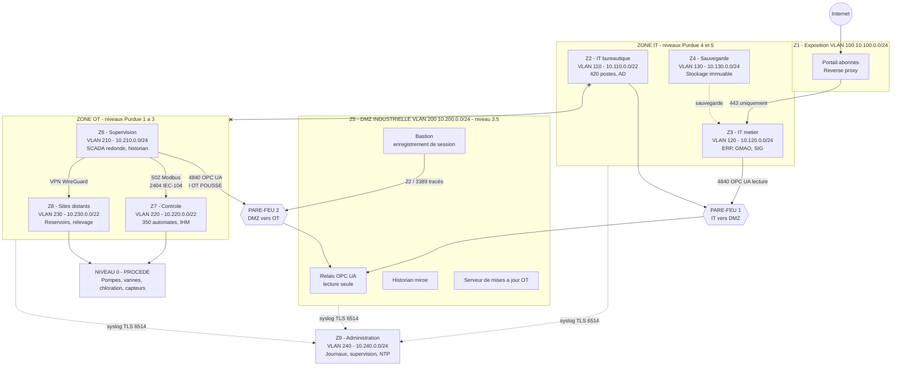

# Bloc 3 — Architecture réseau segmentée IT / OT

> **Objet** : concevoir et justifier une architecture réseau cloisonnant le système d'information de
> gestion (IT) et le système industriel (OT) d'HydroRégie, en garantissant la **continuité du
> service d'eau potable**.
> **Date** : 10 septembre 2026 · **Version** : 1.0
> **Classification** : Diffusion restreinte — 🔴 *ce document décrit le plan d'adressage et les
> règles de filtrage : il ne doit pas être diffusé hors de l'entité.*

---

## 1. Synthèse

| Élément | Choix retenu |
|---|---|
| Référentiel | **IEC 62443** (zones et conduits) + **modèle de Purdue** — conformément à ce que permet l'art. 25 |
| Nombre de zones | **9 zones**, de la criticité « moyenne » à « vitale » |
| Point de passage IT ↔ OT | **DMZ industrielle** (zone Z5) — aucun flux direct |
| Pare-feu | **2 pare-feu en cascade** : IT ↔ DMZ, puis DMZ ↔ OT |
| Protocole de franchissement de zone | **OPC UA** (authentifié et chiffré) — Modbus reste cantonné à l'intérieur de l'OT |
| Accès distants | **VPN + MFA + bastion**, comptes désactivés par défaut |
| Sites distants | **WireGuard**, une clé par site, `AllowedIPs` en /32 |
| Détection | Sonde **passive** sur port miroir |
| Continuité | **3 modes** : nominal, dégradé autonome, manuel — les automates ne dépendent jamais du SCADA |

> 🎯 **La règle en une phrase** : *la bureautique ne parle jamais à l'industriel ; l'industriel
> pousse ses données dans une zone tampon où la bureautique vient les lire.*

---

## 2. La situation actuelle et son problème

### 2.1 L'existant

```
                            INTERNET
                               |
                        [ Box / routeur ]
                               |
        +======================+======================+
        |        RESEAU UNIQUE  10.0.0.0/8            |
        |                                             |
        |  [420 postes]  [AD]  [ERP]  [GMAO]  [SIG]   |
        |  [Serveur de fichiers]  [NAS de sauvegarde] |
        |  [Poste d'ingenierie automates]             |
        |  [SUPERVISEUR SCADA]  [Historian]           |
        |  [350 automates et RTU]                     |
        +=============================================+
                 AUCUN CLOISONNEMENT
```

### 2.2 Le scénario d'attaque que cela permet

| Étape | Action de l'attaquant | Ce qui l'arrête aujourd'hui |
|---|---|---|
| 1 | Courriel piégé ouvert par un agent | Antivirus (parfois) |
| 2 | Exécution de code sur le poste | **Rien** |
| 3 | Découverte du réseau : `nmap` sur 10.0.0.0/8 | **Rien** |
| 4 | Découverte du superviseur SCADA et des automates | **Rien** |
| 5 | Connexion Modbus/TCP (port 502) vers un automate | **Rien** — le protocole n'a pas d'authentification |
| 6 | Écriture d'un registre : arrêt d'une pompe, modification d'une consigne de chloration | **Rien** |

> 🔴 **Six étapes, aucun obstacle.** C'est la justification technique du projet.

---

## 3. Le découpage en zones

### 3.1 Principe

Chaque zone regroupe des équipements de **criticité homogène** et de **besoin de communication
similaire**. Entre deux zones, un **conduit** (au sens IEC 62443) : un ensemble de flux
explicitement autorisés, filtrés par un pare-feu.

### 3.2 Les 9 zones

| Zone | Nom | VLAN | Réseau | Criticité | Contenu | Niveau Purdue |
|---|---|---|---|---|---|---|
| **Z1** | Exposition Internet | 100 | 10.100.0.0/24 | 🟡 Moyenne | Portail abonnés, relais de messagerie, reverse proxy | 5 |
| **Z2** | IT bureautique | 110 | 10.110.0.0/22 | 🟡 Moyenne | 420 postes, AD, serveurs de fichiers, impression | 4-5 |
| **Z3** | IT métier | 120 | 10.120.0.0/24 | 🟠 Haute | ERP facturation, GMAO, SIG, télérelève | 4 |
| **Z4** | Sauvegarde | 130 | 10.130.0.0/24 | 🔴 **Critique** | Serveur de sauvegarde, stockage immuable, robot de bandes | — |
| **Z5** | **DMZ industrielle** | 200 | 10.200.0.0/24 | 🔴 **Critique** | Relais OPC UA, historian miroir, serveur de MAJ OT, bastion | **3.5** |
| **Z6** | Supervision OT | 210 | 10.210.0.0/24 | 🟣 **Vitale** | SCADA redondé, historian primaire, serveur d'alarmes | 3 |
| **Z7** | Contrôle OT | 220 | 10.220.0.0/22 | 🟣 **Vitale** | ~350 automates, RTU des sites principaux, IHM locales | 1-2 |
| **Z8** | Sites distants | 230 | 10.230.0.0/22 | 🟣 **Vitale** | Réservoirs, stations de relevage (VPN sur APN privé) | 1-2 |
| **Z9** | Administration | 240 | 10.240.0.0/24 | 🔴 **Critique** | Bastion d'administration, collecteur de journaux, supervision, NTP | — |

> 💡 **Convention d'adressage** : le 2ᵉ octet reprend le numéro de VLAN (VLAN 210 → 10.210.x.x).
> Un an plus tard, on lit une adresse IP et on sait immédiatement dans quelle zone on se trouve.
> En crise, ce détail fait gagner des minutes.

### 3.3 Justification du niveau de criticité

| Criticité | Critère retenu | Conséquence d'une compromission |
|---|---|---|
| 🟣 **Vitale** | Le procédé de production et de distribution d'eau en dépend | **Arrêt de la distribution ou altération de la qualité de l'eau** → santé publique |
| 🔴 **Critique** | Sa compromission permet d'atteindre une zone vitale, ou empêche la reprise | Perte de la capacité de reconstruire (Z4) ou de contrôler (Z5, Z9) |
| 🟠 **Haute** | Données sensibles, service aux usagers | Fuite de données abonnés (RGPD), interruption de facturation |
| 🟡 **Moyenne** | Exposé mais sans effet direct sur le procédé | Interruption bureautique |

---

## 4. Le schéma d'architecture cible

### 4.1 Vue d'ensemble



> ⛔ La dernière liaison du schéma (`BUR x--x OT`) matérialise **l'interdiction centrale** :
> aucun flux, jamais, entre la bureautique et l'industriel.

### 4.2 Vue en couches (modèle de Purdue)

```
INTERNET
   |
   | 443 sortant / entrant filtre
   v
+--------------------------------------------------------------+
| Z1 EXPOSITION      VLAN 100   Portail abonnes, relais mail    |  Niveau 5
+--------------------------------------------------------------+
| Z2 IT BUREAUTIQUE  VLAN 110   Postes, AD, fichiers            |  Niveau 4-5
| Z3 IT METIER       VLAN 120   ERP, GMAO, SIG                  |  Niveau 4
| Z4 SAUVEGARDE      VLAN 130   Stockage immuable               |
+==============================================================+
|                    PARE-FEU 1  (IT <-> DMZ)                   |
+==============================================================+
| Z5 DMZ INDUSTRIELLE  VLAN 200                                 |  Niveau 3.5
|    Relais OPC UA (lecture seule)                              |
|    Historian miroir | Serveur de MAJ OT | BASTION             |
+==============================================================+
|                    PARE-FEU 2  (DMZ <-> OT)                   |
+==============================================================+
| Z6 SUPERVISION OT  VLAN 210   SCADA redonde, historian        |  Niveau 3
+--------------------------------------------------------------+
| Z7 CONTROLE OT     VLAN 220   350 automates, IHM locales      |  Niveau 1-2
| Z8 SITES DISTANTS  VLAN 230   Reservoirs, stations (VPN)      |  Niveau 1-2
+--------------------------------------------------------------+
| NIVEAU 0  PROCEDE   Pompes, vannes, chloration, capteurs      |  Niveau 0
+--------------------------------------------------------------+

Z9 ADMINISTRATION  VLAN 240 : bastion, collecteur de journaux, NTP
   -> recoit de TOUTES les zones, n'envoie vers AUCUNE (sauf administration via bastion)
```

---

## 5. La matrice de flux

> 🔑 **C'est le vrai livrable technique.** Le schéma illustre ; la matrice se met en œuvre.
> Principe : **DENY par défaut**, chaque ligne est une exception **justifiée** et **validée**.

### 5.1 Flux autorisés

| # | Source | Destination | Port / protocole | Sens | Justification métier | Validé par |
|---|---|---|---|---|---|---|
| F-01 | Internet | Z1 portail | 443/TCP | → | Accès des abonnés à leur espace | DSI |
| F-02 | Z1 portail | Z3 ERP | 443/TCP | → | Consultation des factures | DSI |
| F-03 | Z2 bureautique | Z3 métier | 443/TCP, 1433/TCP | → | Usage de l'ERP et de la GMAO | DSI |
| F-04 | Z3 métier (GMAO) | Z5 relais OPC UA | 4840/TCP | → | Remontée des compteurs horaires des pompes pour la maintenance préventive | Exploitation |
| F-05 | Z3 métier (SIG) | Z5 historian miroir | 1433/TCP | → | Cartographie des débits et pressions | Exploitation |
| F-06 | **Z6 SCADA** | **Z5 relais OPC UA** | 4840/TCP | → | 🔑 **L'OT pousse** ses données vers la DMZ | Exploitation |
| F-07 | Z6 historian | Z5 historian miroir | 1433/TCP | → | Réplication de l'historique | Exploitation |
| F-08 | **Z6 SCADA** | **Z7 automates** | 502/TCP, 2404/TCP | → | 🔑 Pilotage — **seul** flux autorisé vers les automates | Exploitation |
| F-09 | Z6 SCADA | Z8 sites distants | 2404/TCP dans tunnel WireGuard | → | Télégestion des réservoirs et stations | Exploitation |
| F-10 | Z8 sites distants | Z6 SCADA | 2404/TCP dans tunnel | → | Remontée des mesures et alarmes | Exploitation |
| F-11 | Z9 bastion | Z5, Z6, Z7 | 22/TCP, 3389/TCP | → | Administration **depuis le bastion uniquement**, session enregistrée | RSSI |
| F-12 | Z5 serveur MAJ | Z6, Z7 | 445/TCP, 8530/TCP | → | Distribution des correctifs OT en fenêtre planifiée | Exploitation |
| F-13 | Z5 serveur MAJ | Internet | 443/TCP | → | Téléchargement des correctifs — **sortant, initié depuis la DMZ** | DSI |
| F-14 | Toutes zones | Z9 collecteur | 6514/TCP (syslog TLS) | → | Journalisation centralisée (art. 21(2)(b)) | RSSI |
| F-15 | Toutes zones | Z9 serveur NTP | 123/UDP | → | Synchronisation horaire — **prérequis de toute chronologie de crise** | RSSI |
| F-16 | Z2, Z3 | Z4 sauvegarde | Port de l'agent de sauvegarde | → | Sauvegarde — **initiée par le serveur de sauvegarde** | DSI |
| F-17 | VPN prestataires | Z9 bastion | 443/TCP | → | Accès distant, après MFA, **sur activation** | RSSI |

### 5.2 Flux explicitement interdits

| # | Source | Destination | Port | Justification du blocage |
|---|---|---|---|---|
| **D-01** | **Z2 IT bureautique** | **Z5, Z6, Z7, Z8** | **tout** | 🔴 **RÈGLE CENTRALE** — la bureautique ne parle jamais à l'industriel ni à la DMZ |
| D-02 | Z7, Z8 automates | Internet | tout | Un automate n'a rien à faire sur Internet |
| D-03 | **Z5 DMZ** | **Z7, Z8 automates** | tout | La DMZ ne doit jamais devenir un tremplin vers le procédé |
| D-04 | Internet | Z5, Z6, Z7, Z8 | tout entrant | Aucun flux entrant vers l'industriel, sans exception |
| D-05 | Z1 exposition | Z2, Z4 | tout | Un portail compromis n'atteint ni la bureautique ni les sauvegardes |
| D-06 | Toute zone | Z4 sauvegarde | tout sauf agent de sauvegarde | 🔴 Protection des sauvegardes contre le chiffrement |
| D-07 | Z5 DMZ | Z2, Z3 | tout (sens DMZ → IT) | La DMZ ne se connecte pas à l'IT : l'IT vient lire |
| D-08 | Z9 administration | Internet | tout | La zone d'administration reste hors ligne |
| D-09 | Z7 | Z6 | tout initié par un automate | Un automate compromis ne remonte pas vers le SCADA |
| **D-10** | **any** | **any** | **tout** | 🔴 **DENY ALL journalisé — dernière règle de chaque interface** |

> 💡 **Pourquoi écrire D-01 explicitement, alors que D-10 bloque déjà tout ?**
> Pour la **journalisation** et la **preuve**. Une règle nommée produit une ligne de journal
> identifiable, exploitable en détection (art. 21(2)(b)) et comme preuve lors d'un contrôle
> (art. 32(2)).

---

## 6. Justification des choix techniques

### 6.1 Pourquoi deux pare-feu et pas un seul

| Option | Avantage | Inconvénient | Décision |
|---|---|---|---|
| Un seul pare-feu multi-interfaces | Coût réduit, administration simple | Une compromission = toute la segmentation tombe | ❌ Écartée |
| **Deux pare-feu en cascade** | Défense en profondeur ; jeux de règles et administrateurs distincts | Coût et exploitation doublés | ✅ **Retenue** |
| Deux pare-feu de **constructeurs différents** | Une vulnérabilité ne touche pas les deux | Deux compétences à maintenir, coût de formation | 🟡 **Non retenue en phase 1** |

📕 **Décision assumée** : deux pare-feu **de même constructeur**, mais avec des **jeux de règles
séparés**, des **comptes d'administration distincts** et des **cycles de mise à jour décalés**.
Compromis entre sécurité et capacité d'exploitation d'une équipe de trois personnes.
**À réévaluer** au renouvellement. C'est exactement le raisonnement de proportionnalité de
l'art. 21(1) — et le fait de l'écrire est ce qui le rend défendable.

### 6.2 Pourquoi OPC UA pour franchir la frontière de zone

| Critère | Modbus/TCP | **OPC UA** |
|---|---|---|
| Authentification | ❌ Aucune | ✅ Certificats et comptes |
| Chiffrement | ❌ Aucun | ✅ `Sign` / `SignAndEncrypt` |
| Contrôle d'accès fin | ❌ Non | ✅ Par nœud, lecture seule possible |
| Traçabilité | ❌ Non | ✅ Journalisation applicative |

➡️ **Modbus reste cantonné à l'intérieur de la zone Z7** (SCADA → automates), où sa faiblesse est
compensée par l'isolement réseau. **Aucune frontière de zone n'est franchie en Modbus.**

### 6.3 Pourquoi une DMZ plutôt qu'un flux direct filtré

Un flux direct Z3 → Z6, même restreint au port 4840, laisserait subsister une **session de bout en
bout** entre l'IT et l'OT. Une vulnérabilité du serveur OPC du SCADA serait alors exploitable depuis
l'IT.

Avec la DMZ : la session de l'IT **se termine sur le relais**. Pour atteindre le SCADA, un attaquant
devrait compromettre le relais **puis** trouver un chemin retour — que **D-03** interdit et que le
sens des flux rend inexistant (c'est l'OT qui pousse).

### 6.4 Pourquoi pas de diode réseau en phase 1

| | Pour | Contre |
|---|---|---|
| Diode de données | Garantie **matérielle** d'unidirectionnalité | 30 à 80 k€ 📕, télémaintenance impossible par ce canal, protocoles spécifiques |

📕 **Décision** : non retenue en phase 1. Le gain marginal par rapport à une DMZ correctement
configurée ne justifie pas le coût au regard des autres priorités (MFA, sauvegardes, détection),
qui couvrent des risques plus probables. **À réévaluer** si un flux temps réel devait être ouvert
vers un tiers externe (délégataire, autorité). *Décision et motif tracés — art. 21(1).*

### 6.5 Pourquoi WireGuard pour les sites distants

| Solution | Verdict |
|---|---|
| **APN privé 4G seul** | ❌ Insuffisant : isole d'Internet mais ne chiffre pas de bout en bout et ne protège pas d'un équipement voisin compromis |
| **IPsec** | 🟡 Fonctionnel mais lourd à configurer sur 60+ sites |
| **WireGuard** | ✅ **Retenu** : léger (adapté aux RTU), rapide à remonter après coupure, une **clé par site** |

```
# Concentrateur : une cle publique et UN SEUL hote autorise par site
[Peer]
PublicKey  = <cle-publique-reservoir-nord>
AllowedIPs = 10.230.1.12/32        # /32 : un site compromis ne peut pas usurper un autre site
PersistentKeepalive = 25
```

> 🔑 **Le `/32` est le détail qui compte.** Mettre `10.230.0.0/22` permettrait à un site compromis
> d'usurper l'adresse de n'importe quel autre site.

### 6.6 Pourquoi une sonde passive et non un système de blocage

Un équipement de blocage en coupure (IPS) sur un réseau industriel peut, sur un faux positif,
**interrompre une régulation** — donc la distribution d'eau. En OT, la **sûreté prime**.

➡️ Sonde **passive** sur port miroir : elle voit tout, ne peut rien casser. Le blocage reste assuré
par les pare-feu, dont les règles sont statiques et testées.

---

## 7. La continuité du service d'eau potable

📗 Exigence de l'**article 21(2)(c)** : continuité des activités et gestion de crise.

> 🔴 **Exigence directrice de toute l'architecture** :
> **l'eau doit continuer de couler même si la totalité de l'informatique est arrêtée.**

### 7.1 Les trois modes de fonctionnement

| Mode | Déclencheur | Ce qui fonctionne | Ce qu'on perd | Durée tenable 📕 |
|---|---|---|---|---|
| **Nominal** | — | Télégestion complète, optimisation énergétique, alarmes centralisées | — | — |
| **Dégradé — autonomie locale** | SCADA indisponible **ou isolé volontairement** | Les **automates régulent seuls** : niveau, pression, chloration asservie au débit. IHM locales sur site | Vision centralisée, optimisation, alarmes à distance | **Plusieurs jours** |
| **Manuel** | Automate hors service ou site inaccessible | Manœuvres humaines, dosage vérifié par **prélèvements** toutes les 4 h | Réactivité, précision ; charge en personnel très élevée | **Quelques jours** avec renfort |

### 7.2 Les décisions d'architecture qui en découlent

| # | Exigence | Pourquoi |
|---|---|---|
| 1 | 🔴 **Les automates embarquent une logique de repli autonome** et ne dépendent **jamais** du SCADA pour maintenir le service | C'est ce qui permet de **couper le lien IT/OT en 5 minutes** sans arrêter l'eau |
| 2 | Une **IHM locale** est présente sur chaque site majeur | Exploitation possible sans le réseau |
| 3 | Les **réservoirs** disposent d'une autonomie de plusieurs heures | Temps tampon pour réagir |
| 4 | Le lien Z6 ↔ Z7 est **coupable physiquement** (procédure documentée, testée) | La coupure est une **décision d'exploitation**, pas une opération d'urgence improvisée |
| 5 | La logique de sûreté (seuils critiques, arrêts de sécurité) est **câblée**, pas seulement logicielle | Une logique logicielle corrompue ne doit pas pouvoir déclencher un incident de sécurité |
| 6 | Cette exigence est **écrite dans les cahiers des charges** des intégrateurs | Art. 21(2)(d) — chaîne d'approvisionnement |
| 7 | Elle est **testée une fois par an** en conditions réelles | Art. 21(2)(f) — évaluation de l'efficacité |

### 7.3 Le scénario « on coupe tout » — chronométré 📕

```
T+0 min    Suspicion de propagation vers l'OT
T+5 min    Decision : couper le lien Z5 <-> Z6 (responsable exploitation + RSSI)
T+10 min   Lien coupe. Les automates passent en autonomie locale.
           >>> LA DISTRIBUTION D'EAU N'EST PAS INTERROMPUE <<<
T+30 min   Astreinte deployee sur les 2 usines et les 4 sites sensibles
T+2 h      Surveillance par IHM locales et rondes ; frequence des releves : 2 h
T+24 h     Mode degrade stabilise ; traitement de l'incident IT en parallele
J+3        Verification d'integrite des automates avant reconnexion progressive
```

> 🎯 **C'est le point qui distingue ce rendu.** La question n'est pas « comment empêcher
> l'attaque ? » mais « **comment continuer à distribuer de l'eau pendant l'attaque ?** ».

---

## 8. Mise en œuvre : la migration sans coupure

| Étape | Action | Durée 📕 | Risque | Retour arrière |
|---|---|---|---|---|
| 1 | **Cartographie passive** des flux réels (4 semaines, incluant un week-end et une astreinte) | 1 mois | Nul | — |
| 2 | Rédaction de la **matrice de flux**, **validée par l'exploitation** | 1 mois | Nul | — |
| 3 | Création des VLAN et du routage, **sans filtrage** | 1 mois | Faible | Retour au VLAN unique |
| 4 | Bascule des équipements **par lots**, IT d'abord, OT ensuite | 3 mois | Modéré | Re-basculement du lot |
| 5 | Filtrage en **journalisation seule** (2 semaines) | 2 sem. | Faible | Aucune règle bloquante |
| 6 | Passage en **blocage**, zone par zone, de la moins critique à la plus critique | 1 mois | Maîtrisé | Retour en journalisation seule |
| 7 | **Audit de segmentation** par un tiers | 2 sem. | Nul | — |

> 🔑 **L'étape 5 est celle qu'on est tenté de sauter.** Elle révèle les flux non documentés — sonde
> de qualité qui émet en direct, imprimante de laboratoire, licence flottante d'un logiciel métier —
> **avant** de casser quoi que ce soit.

### Règles d'or de la migration

1. **Jamais de bascule un vendredi** ni la veille d'un jour férié.
2. **Jamais pendant une pointe de consommation** (été, épisode de forte chaleur).
3. **L'exploitation a un droit de veto** sur toute fenêtre de bascule.
4. **Un retour arrière testé** avant chaque étape, pas seulement écrit.

---

## 9. Ce que l'architecture change, mesuré

| Scénario | Avant | Après |
|---|---|---|
| Poste bureautique compromis atteint un automate | ✅ En 3 étapes | ⛔ **Bloqué** par D-01 (journalisé et alerté) |
| Rançongiciel chiffre le SCADA | ✅ Possible | 🟡 Possible, mais **l'eau continue de couler** (mode dégradé) |
| Rançongiciel chiffre les sauvegardes | ✅ Possible | ⛔ **Bloqué** par D-06 + copie hors ligne |
| Intégrateur compromis atteint tous les automates | ✅ Possible | 🟡 Limité au périmètre du ticket, session enregistrée |
| Automate compromis exfiltre vers Internet | ✅ Possible | ⛔ **Bloqué** par D-02 |
| Attaquant efface ses traces | ✅ Possible | ⛔ Journaux poussés en Z9, isolée |
| Reconnaissance réseau depuis la bureautique | ✅ Tout le SI visible | 🟡 Seule la zone Z2 est visible |

### Couverture des mesures de l'article 21

| Domaine | Contribution de l'architecture |
|---|---|
| 21(2)(a) | Les zones traduisent l'analyse de risques en découpage technique |
| 21(2)(b) | **Contention** de l'incident + journalisation centralisée pour la détection |
| 21(2)(c) | **Continuité de la distribution** garantie par les modes dégradés |
| 21(2)(e) | **Mesure compensatoire** pour les automates non corrigeables |
| 21(2)(h) | OPC UA chiffré aux frontières, VPN chiffrés |
| 21(2)(i) | Point de passage unique et tracé pour l'administration |
| 21(2)(j) | MFA sur tous les accès distants, bastion, communication d'urgence hors domaine |

---

## 10. Limites et points d'attention

Un rendu honnête dit aussi ce qu'il ne fait pas.

| Limite | Portée | Traitement prévu |
|---|---|---|
| La segmentation **ne protège pas** contre un poste d'ingénierie légitime compromis | Un administrateur OT reste un point de défaillance | Bastion, MFA, moindre privilège, surveillance des sessions |
| Les automates restent **vulnérables** en eux-mêmes | Protocoles sans authentification | Isolement + détection + remplacement progressif |
| L'attaque par **clé USB** contourne le réseau | Poste d'ingénierie, mises à jour terrain | Poste de décontamination, procédure, sensibilisation |
| La DMZ devient un **point de concentration** | Si elle tombe, la remontée de données s'arrête | Durcissement renforcé, supervision, mais l'OT reste protégé par D-03 |
| **Coût d'exploitation** de deux pare-feu | Charge sur une équipe de 3 personnes | Formation, procédures, automatisation des sauvegardes de configuration |
| Les **60 000 compteurs communicants** ne sont pas traités ici | Périmètre distinct (télérelève radio) | À traiter dans une phase ultérieure — **écart assumé et documenté** |

---

## 11. Conclusion

L'architecture proposée cloisonne l'IT et l'OT en **9 zones** de criticité homogène, séparées par
**deux pare-feu en cascade** et une **DMZ industrielle** qui constitue le seul point de rencontre
entre les deux mondes. Aucun flux direct entre la bureautique et l'industriel n'est autorisé, et le
seul protocole franchissant une frontière de zone est **OPC UA**, authentifié et chiffré.

Trois principes la résument :

1. **Personne ne traverse.** L'OT pousse, l'IT lit — dans une zone tampon.
2. **Tout est justifié.** Chaque ligne de la matrice porte une justification métier et un validateur.
3. **L'eau coule quand même.** Les automates régulent seuls, et couper le lien IT/OT est une
   décision d'exploitation de cinq minutes, testée une fois par an.

---

📎 **Fichiers techniques associés**

| Fichier | Contenu |
|---|---|
| [`scripts/reseau/vlan-switch.cfg`](../scripts/reseau/vlan-switch.cfg) | Configuration type des commutateurs |
| [`scripts/pare-feu/nftables-segmentation.nft`](../scripts/pare-feu/nftables-segmentation.nft) | Règles de filtrage complètes |
| [`scripts/reseau/wireguard-site-distant.conf`](../scripts/reseau/wireguard-site-distant.conf) | Tunnel type d'un site distant |
| [`scripts/verification/test-segmentation.sh`](../scripts/verification/test-segmentation.sh) | Script de test de la segmentation |
| [`schemas/`](../schemas/) | Schémas avant / après |

⬅️ [Bloc 2 — Analyse d'écart](job-2-analyse-ecart.md) · ➡️ [Bloc 4 — Crise et notifications](job-4-crise-notifications.md)
