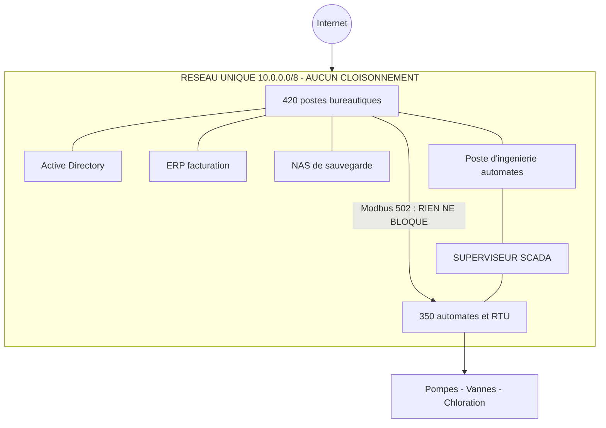
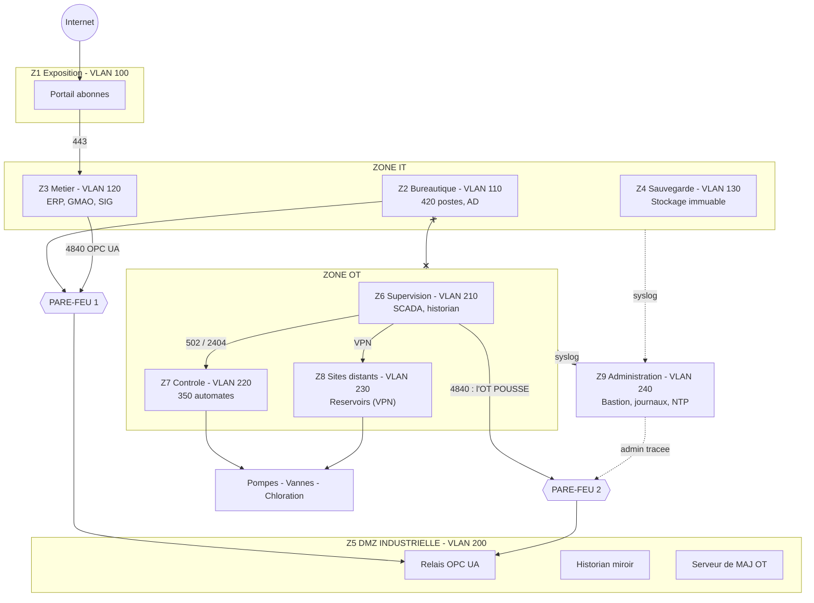
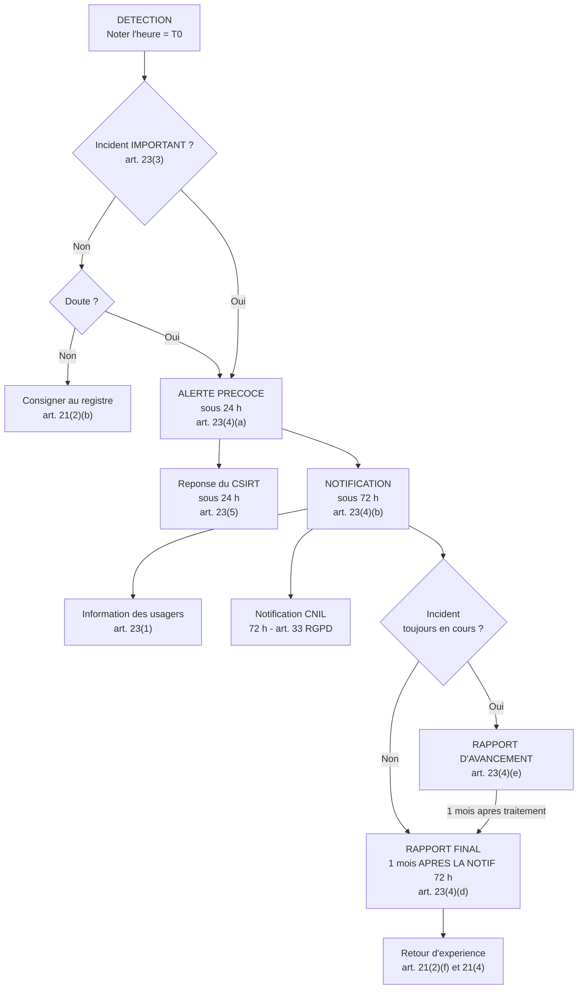

# 🖼️ schemas/ — schémas d'architecture

> Les schémas sont écrits en **Mermaid** : ils sont versionnés comme du texte (donc `git diff`
> fonctionne) et **GitHub les affiche directement** dans le navigateur.

| Fichier | Contenu |
|---|---|
| [`architecture-avant.mmd`](architecture-avant.mmd) | L'existant : réseau plat, aucun cloisonnement |
| [`architecture-apres.mmd`](architecture-apres.mmd) | La cible : 9 zones, DMZ industrielle, 2 pare-feu |
| [`flux-notification.mmd`](flux-notification.mmd) | Le processus de notification 24 h / 72 h / 1 mois |

---

## 1. AVANT — le réseau plat



> 🔴 **Le problème en une flèche** : un poste bureautique peut ouvrir une session Modbus/TCP vers
> un automate, sans franchir le moindre équipement de filtrage.

---

## 2. APRÈS — le réseau segmenté



> ✅ **Ce qui change** : plus aucun chemin direct entre la bureautique et l'industriel.
> L'OT **pousse** ses données dans la DMZ, l'IT **vient les lire**. Aucune session ne traverse.

---

## 3. Le processus de notification



> 🔴 **Le piège** : le mois du rapport final court à compter de la **notification des 72 h**,
> pas de T0.

---

## 4. Comment exporter ces schémas en image

Pour une soutenance ou un document Word :

```bash
# Avec mermaid-cli (npm, licence MIT)
npx @mermaid-js/mermaid-cli -i architecture-apres.mmd -o architecture-apres.png -w 2400
```

Ou par copier-coller dans l'éditeur en ligne **mermaid.live**, puis export PNG / SVG.

⬅️ [Retour au README principal](../README.md)
